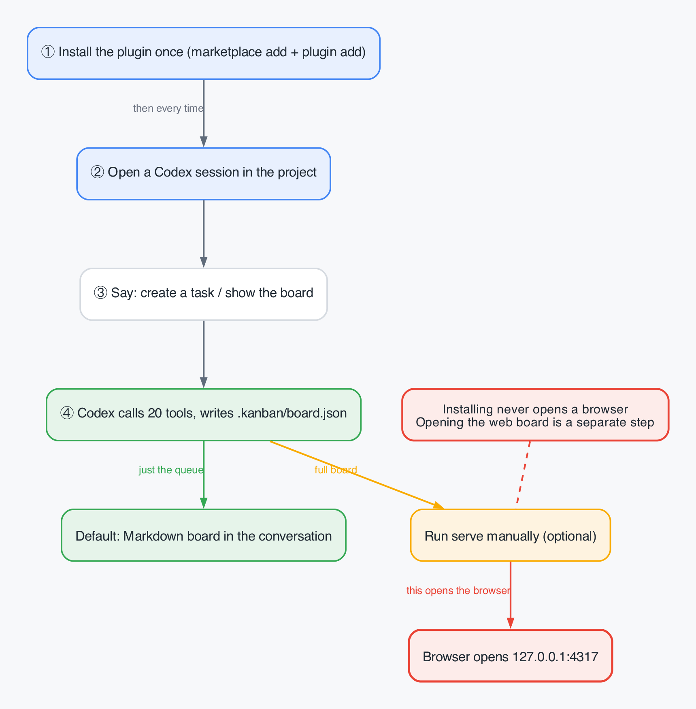
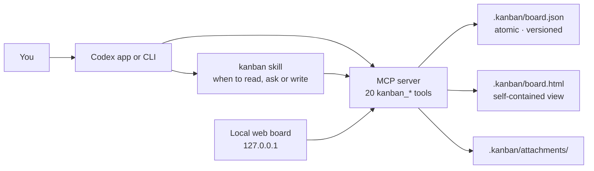

<p align="center">
  
</p>

<h1 align="center">Codex Kanban</h1>

<p align="center"><strong>A Codex-native task board: projects, four columns, approvals, blockers, attachments and durable repository state.</strong></p>

<p align="center">
  <a href="https://github.com/SilasSolivagus/codex-kanban/actions/workflows/ci.yml"></a>
  
  
  
  <a href="LICENSE"></a>
</p>

<p align="center">English · <a href="README.zh-CN.md">简体中文</a></p>


Codex Kanban gives Codex a task layer that outlives the conversation. Projects,
tasks, questions, blockers, comments, activity and attachments live in
`.kanban/board.json` inside your repository, so they survive restarts, show up in
code review, and belong to the project rather than to a chat.

Codex reads and writes the board through 20 MCP tools and a small `kanban` skill.
Humans get the same board as a local web app at `127.0.0.1`, plus a CLI for scripting.
There is no hosted service, no database, no account, and no runtime dependency.

## What you get

| | |
| --- | --- |
| **Four columns, six statuses** | Backlog (`backlog`, `todo`), Running (`in_progress`), Needs you (computed), Done (`done`). `in_review` also waits in Needs you; `canceled` stays out of the board. |
| **Needs you is automatic** | Computed from open questions, active blockers and review state. Priority is question → blocked → review. It is not a move target. |
| **Human approval boundary** | Approve and reject require `as: "user"` plus `confirmed_by`. An agent cannot move a task out of `in_review`, and cannot close one it opened for review. |
| **Questions with options** | Two to five real options with per-option detail. One click selects, one confirm records the answer and decides. |
| **Blockers with one reason** | Block when external work is missing; the card shows an amber blocked strip and leaves Needs you when cleared. |
| **Projects** | Several workstreams per repository, each with its own identifier prefix and counter. `APP-1` and `WEB-1` coexist in one board. |
| **Archive and restore** | Projects and tasks can be archived. Archived projects are read-only at the domain layer; archived tasks are hidden until you toggle **Show archived**. |
| **Attachments** | Upload from the task drawer, stored under `.kanban/attachments/`, 10 MB per file, downloadable over HTTP. |
| **Ordering** | Drag between columns and within a column; `sortOrder` persists. Keyboard: `Alt+↑/↓` reorders, `Alt+←/→` moves columns. |
| **Search and filters** | Text search plus priority, label and assignee filters, with removable chips and `X / Y` counts. |
| **Bilingual, keyboard-first** | Chinese and English UI, `/` search, `n` new task, `Esc` closes layer by layer, reduced-motion support. |
| **Durable, reviewable state** | A plain JSON file with atomic, versioned writes. Commit it with the code and review task changes in the same diff. |

## Install

Requirements: Codex with plugin support, and Node.js 22 or newer.

```bash
codex plugin marketplace add https://github.com/SilasSolivagus/codex-kanban
codex plugin add codex-kanban@silassolivagus
```

For a local checkout, point the marketplace at the directory:

```bash
codex plugin marketplace add /path/to/codex-kanban
codex plugin add codex-kanban@silassolivagus
```

Update later with:

```bash
codex plugin marketplace upgrade silassolivagus
codex plugin add codex-kanban@silassolivagus
```

Start a new Codex session in the repository you want to track. The `kanban` skill
loads with the plugin and the MCP server exposes the tools below.

## Three ways to use it



Installing the plugin never opens a browser. The default board appears in the
conversation; the web board is a separate `serve` step. The three entry points below
cover the whole loop.

### 1. In Codex (agent writes, you decide)

> "Track the SSO redirect bug as a high-priority task with the `auth` label. Ask me
> whether staging or production should get the fix first."

Codex creates the task, posts a question with options, and leaves it in Needs you.
Answer it, then say "approve with the staging option" — Codex records the answer and
closes the task with your confirmation. Ask "what needs me?" any time to get just the
attention queue.

### 2. Local web board (for humans)

```bash
# from a checkout
node plugin/bin/codex-kanban.mjs serve --open

# from the installed plugin (version may differ)
node "$HOME/.codex/plugins/cache/silassolivagus/codex-kanban/0.6.3/bin/codex-kanban.mjs" serve --open
```

Opens `http://127.0.0.1:4317`: four columns with drag ordering, project switcher,
search and filters, a full task drawer (details, collaboration, activity), inline
question panels, attachments, archive, and a zh/en toggle.


The server binds to loopback by default, has no account system, and makes no
outbound requests. `--port` changes the port; `--host 0.0.0.0` exposes it to your
network and should only be used on a machine you trust.

### 3. CLI (for scripts)

```bash
node plugin/bin/codex-kanban.mjs board
node plugin/bin/codex-kanban.mjs add "Fix the login redirect" \
  --description "Users land on / after SSO instead of the page they came from." \
  --priority high --label auth
node plugin/bin/codex-kanban.mjs move 1 --to in_progress
node plugin/bin/codex-kanban.mjs ask 1 \
  --prompt "Which environment should get the fix first?" \
  --option Staging --option Production
node plugin/bin/codex-kanban.mjs approve 1 --confirmed-by "Staging first"
node plugin/bin/codex-kanban.mjs render --open
```

Numeric references such as `1` resolve to `<prefix>-1`. `--root PATH` points at
another repository; by default the CLI uses the nearest directory above the current
one that contains `.git` or `.kanban`.

## Tools

Every tool takes `root`, the absolute repository path. It is required unless
`CODEX_KANBAN_ROOT` is set; there is deliberately no fallback to the server's working
directory, because an installed plugin runs from the plugin cache. Writes to an
existing task take the current `version` from `kanban_task_get`; approve and reject
also require `as: "user"` and `confirmed_by`.

| Tool | What it does |
| --- | --- |
| `kanban_board` | Render the Markdown board, Needs you first, optionally filtered by project or column. |
| `kanban_task_get` | Read one task with description, question, blocker, links, attachments, comments, activity and current version. |
| `kanban_task_create` | Create a task in a project, in Backlog or a given status, and return its identifier. |
| `kanban_task_update` | Change title, description, priority, labels or links. |
| `kanban_task_move` | Move a task to a column or stored status, or reorder within a column. |
| `kanban_task_block` | Record one actionable blocker. |
| `kanban_task_unblock` | Clear the blocker. |
| `kanban_task_ask` | Post a question with two to five options. |
| `kanban_task_answer` | Record the selected option and a note. |
| `kanban_task_approve` | Human-only: approve and close the task as Done. |
| `kanban_task_reject` | Human-only: reject with a note and send the task back to Backlog. |
| `kanban_task_comment` | Append a comment that stays with the task. |
| `kanban_task_archive` | Hide a task from the board without deleting it. |
| `kanban_task_restore` | Bring an archived task back. |
| `kanban_render` | Write `.kanban/board.html` and return its path plus the inline visual reference. |
| `kanban_project_list` | List projects with prefix, archive state and task counts. |
| `kanban_project_create` | Create a project with an optional prefix and workspace path. |
| `kanban_project_update` | Rename a project, change its prefix, or set its workspace path. |
| `kanban_project_archive` | Archive a project; its tasks become read-only. |
| `kanban_project_restore` | Restore an archived project. |

## Projects, archive and attachments

- A board can hold several projects. Each has its own prefix and counter; identifiers
  are unique per project, not per repository.
- Archiving is enforced in the domain layer: a write to a task in an archived project
  fails with `PROJECT_ARCHIVED`; a write to an archived task fails with `TASK_ARCHIVED`.
- Attachments are files under `.kanban/attachments/<id>` with metadata on the task.
  Add `.kanban/attachments/` to `.gitignore` if you do not want binaries in git.
- Needs you, blocked and review are overlays computed from state; they never overwrite
  the stored status.

## Architecture



The skill owns policy — read before answering, ask instead of blocking when a human
decision is missing, never approve its own work. The server owns the data path: one
board per repository, every write through the same store. The HTML file never writes
back.

## Data model

The board is created on the first write (schema 2):

```json
{
  "schema": 2,
  "projects": [
    {
      "id": "prj_default",
      "name": "my-app",
      "prefix": "MYAPP",
      "workspacePath": null,
      "nextTaskNumber": 2,
      "archivedAt": null,
      "createdAt": "2026-10-22T07:45:38.341Z",
      "updatedAt": "2026-10-22T07:45:38.341Z"
    }
  ],
  "tasks": [
    {
      "id": "tsk_8116bbc1-7390-4031-9c1f-719fd79c6f3b",
      "projectId": "prj_default",
      "identifier": "MYAPP-1",
      "title": "Fix the login redirect",
      "status": "in_progress",
      "priority": "high",
      "labels": ["auth"],
      "blockedReason": null,
      "pendingQuestion": null,
      "links": [],
      "attachments": [],
      "comments": [],
      "activity": [],
      "archivedAt": null,
      "version": 3,
      "createdAt": "2026-10-22T07:45:38.342Z",
      "updatedAt": "2026-10-22T07:46:12.000Z"
    }
  ]
}
```

A v1 board is migrated in place on first read. `version` starts at 1 and increments on
every change; a write must pass the version it read. Stale writes fail with
`TASK_VERSION_CONFLICT`, missing versions with `VERSION_REQUIRED`. Writes are
serialized with `.kanban/board.lock` and applied by writing `board.json.tmp`, syncing,
then renaming.

## UX quality

The web board was audited twice by an independent designer against the dsh-kanban
reference, with screenshots and a goodwill meter:

| Round | Design score | AI-slop | Goodwill | Findings |
| --- | --- | --- | --- | --- |
| 1 | C (2.80/4) | B | 43/100 | 10 findings |
| 2 | **B (3.42/4)** | B | **90/100** | 9/10 fixed, 0 regressions |

Reports, screenshots and the remaining residue live in [`docs/ux-review/`](docs/ux-review/).
The UI supports keyboard navigation, visible focus, `prefers-reduced-motion`, and a
4.83:1 minimum contrast for metadata.

## Known limitations

- **The approval boundary is cooperative, not authenticated.** `as: "user"` and
  `confirmed_by` are declarations enforced by the tools and the skill. An agent that
  deliberately lies, runs the CLI, or edits `board.json` can bypass them; the real
  protection is that the board is plain JSON you review in the diff.
- **No realtime collaboration.** Two people on the same board rely on git; the web
  server is single-user and loopback-only.
- **One repository per board.** Projects are workstreams inside a repository, not a
  global cross-repo board.
- **The in-app visual is not verified end to end.** `kanban_render` writes the HTML and
  returns a host reference; the Markdown board is the verified path in every client.
- **`confirmed_by` is a gate, not an audit field.** It is not persisted as its own
  field; use the decision note if you need the exact words.
- **Scale is untested beyond demo boards.** Filtering and rendering were checked with
  a few dozen tasks, not hundreds.

## Roadmap

- A global board across repositories, with the same file-per-repo escape hatch.
- Persist the human confirmation with the approval so the audit trail carries the
  exact words.
- Multi-user awareness (who is viewing, soft locks) without turning the board into a
  service.
- Bundle the web board as a single command in the installed plugin cache.

## Development

```bash
git clone https://github.com/SilasSolivagus/codex-kanban.git
cd codex-kanban
node --test
```

The suite has 272 tests at `v0.6.3`, uses only `node:test`, and needs no dependencies.
`npm test` runs the same command.

```
.agents/plugins/marketplace.json   local marketplace entry
plugin/.codex-plugin/plugin.json   plugin manifest
plugin/.mcp.json                   MCP server configuration
plugin/bin/                       launcher and CLI
plugin/server/                    JSON-RPC stdio server, HTTP API
plugin/src/                       domain, store, rules, renderers, web UI
plugin/skills/kanban/SKILL.md     agent-facing workflow
test/                             node:test suites
docs/ux-review/                   audits, evidence and batch reports
```

See [CONTRIBUTING.md](CONTRIBUTING.md) and the human guides:
[English](docs/usage.en.md) · [简体中文](docs/usage.md).

## License

MIT © 2026 Silas Solivagus. See [LICENSE](LICENSE).
