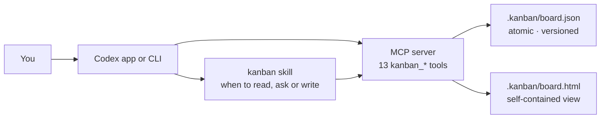

<p align="center">
  
</p>

<h1 align="center">Codex Kanban</h1>

<p align="center"><strong>A Codex-native task board: four columns, approvals, blockers and durable repository state.</strong></p>

<p align="center">
  <a href="https://github.com/SilasSolivagus/codex-kanban/actions/workflows/ci.yml"></a>
  <a href="https://github.com/SilasSolivagus/codex-kanban"></a>
  
  <a href="LICENSE"></a>
</p>

<p align="center">English · <a href="README.zh-CN.md">简体中文</a></p>


Codex Kanban gives Codex a task layer that outlives the conversation. Tasks live in
`.kanban/board.json` inside your repository, so they survive restarts, show up in
code review, and belong to the project rather than to a chat. Codex reads and writes
the board through 13 MCP tools and a small `kanban` skill that decides when a task
should be opened, blocked, or sent to a human.

There is no hosted service, database, or runtime dependency. The board is a JSON
file; the Markdown board is the primary view; the HTML board is a self-contained
extra when you want to see the whole queue at once.

## Features

| | |
| --- | --- |
| **Four columns, six statuses** | Backlog (`backlog`, `todo`), Running (`in_progress`), Needs you (computed), Done (`done`). `in_review` also waits in Needs you; `canceled` is hidden from the board. |
| **Needs you is automatic** | The column is computed from open questions, active blockers and review state. Priority is question, then blocked, then review. It is never a drag target. |
| **Human approval boundary** | `kanban_task_approve` and `kanban_task_reject` require `as: "user"` plus `confirmed_by`. An agent cannot close an `in_review` task by moving it to Done. |
| **Questions with options** | Ask with two to five real options. An answer is recorded, but the task stays in Needs you until a human approves or rejects it. |
| **Blockers with one clear reason** | Block a task when external work is missing: access, a dependency, an environment, or another person's deliverable. Unblock returns it to its normal column. |
| **Durable, reviewable state** | A plain JSON file in the repository. Commit it with the code and review task changes in the same diff. |
| **Atomic, versioned writes** | Every write uses a lock, a temporary file and an atomic rename. Every task update carries a version; stale writes fail with `TASK_VERSION_CONFLICT`. |
| **Two surfaces** | Markdown for the terminal and the conversation; a self-contained HTML board for a visual pass. |
| **No runtime dependencies** | Node.js 22 or newer, ESM, no build step, no package install. |

## Install

Requirements: Codex with plugin support, and Node.js 22 or newer.

Install from the repository marketplace:

```bash
codex plugin marketplace add https://github.com/SilasSolivagus/codex-kanban
codex plugin add codex-kanban@silassolivagus
```

For a local checkout, point the marketplace at the directory instead:

```bash
codex plugin marketplace add /path/to/codex-kanban
codex plugin add codex-kanban@silassolivagus
```

Start a new Codex session in the repository you want to track. The `kanban` skill
is loaded with the plugin, and the MCP server exposes the 13 tools below.

## Use it

Three prompts that exercise the main flows:

**See what needs a person.**

> "What needs me? Show only the Needs you column."

Codex reads the board, returns the attention queue, and keeps the rest out of the
way.

**Track work that should survive the chat.**

> "Track the SSO redirect bug as a high-priority task with the `auth` label. Ask me
> whether staging or production should get the fix first."

Codex creates the task, posts a question with options, and leaves it in Needs you.

**Close the loop after a human decision.**

> "I approved the release notes with the staging option. Close that task with my
> approval, then render the board."

Codex answers the question, records the approval with the human's confirmation,
moves the task to Done, and renders `.kanban/board.html`.

## Tools

All tools accept an optional `root` (absolute repository path). Writes to an
existing task take the current `version` from `kanban_task_get`; approve and reject
also require `as: "user"` and `confirmed_by`.

| Tool | What it does |
| --- | --- |
| `kanban_board` | Render the Markdown board, Needs you first, optionally limited to one column or without Done. |
| `kanban_task_get` | Read one task with description, question, blocker, links, comments, activity and current version. |
| `kanban_task_create` | Create a task in Backlog or a given status and return its identifier. |
| `kanban_task_update` | Change title, description, priority, labels or links without moving the task. |
| `kanban_task_move` | Move a task to a column or stored status; Needs you cannot be chosen. |
| `kanban_task_block` | Record one actionable blocker and move the task to Needs you. |
| `kanban_task_unblock` | Clear the blocker and return the task to its normal column. |
| `kanban_task_ask` | Post a question with two to five options and move the task to Needs you. |
| `kanban_task_answer` | Record the selected option and a note on an open question. |
| `kanban_task_approve` | Human-only: approve and close the task as Done. |
| `kanban_task_reject` | Human-only: reject with a note and send the task back to Backlog. |
| `kanban_task_comment` | Append a comment that stays with the task. |
| `kanban_render` | Write `.kanban/board.html` and return its path plus the inline visual reference. |

## Architecture



The skill decides policy: read the board before answering, ask instead of blocking
when a human decision is missing, never approve its own work. The MCP server owns
the data path: one board per repository, all reads and writes through the same
store. The HTML file never writes back.

## CLI

The CLI exposes the same store without Codex in the loop. From a checkout:

```bash
node plugin/bin/codex-kanban.mjs board
node plugin/bin/codex-kanban.mjs add "Fix the login redirect" \
  --description "Users land on / after SSO instead of the page they came from." \
  --priority high --label auth
node plugin/bin/codex-kanban.mjs move 1 --to in_progress
node plugin/bin/codex-kanban.mjs ask 1 \
  --prompt "Which environment should get the fix first?" \
  --option Staging \
  --option Production
node plugin/bin/codex-kanban.mjs answer 1 --option opt_1
node plugin/bin/codex-kanban.mjs approve 1 --confirmed-by "Staging first"
node plugin/bin/codex-kanban.mjs render --open
```

- Numeric references such as `1` resolve to `<project-prefix>-1`.
- `--root PATH` points at another repository. By default the CLI uses the first
  directory at or above the current directory that contains `.git` or `.kanban`.
- The CLI runs as the human by default. `approve` and `reject` always run as the
  human and require `--confirmed-by`.
- When the plugin is installed, the entry point lives under
  `$CODEX_HOME/plugins/cache/silassolivagus/codex-kanban/<version>/bin/codex-kanban.mjs`.
  With the default Codex home on version 0.1.0:

```bash
node "$HOME/.codex/plugins/cache/silassolivagus/codex-kanban/0.1.0/bin/codex-kanban.mjs" board --root "$PWD"
```

## Data model

The board is created on the first write:

```json
{
  "schema": 1,
  "project": { "name": "my-app", "prefix": "MYAPP", "createdAt": "2026-10-22T07:45:38.341Z" },
  "nextTaskNumber": 2,
  "tasks": [
    {
      "id": "tsk_8116bbc1-7390-4031-9c1f-719fd79c6f3b",
      "identifier": "MYAPP-1",
      "title": "Fix the login redirect",
      "status": "in_progress",
      "priority": "high",
      "labels": ["auth"],
      "blockedReason": null,
      "pendingQuestion": null,
      "version": 3,
      "createdAt": "2026-10-22T07:45:38.342Z",
      "updatedAt": "2026-10-22T07:46:12.000Z"
    }
  ]
}
```

`version` starts at 1 and increments whenever a task changes. A write must pass the
version it read; a stale version fails with `TASK_VERSION_CONFLICT`, while a missing
one fails with `VERSION_REQUIRED`. Writes are serialized with `.kanban/board.lock`
and applied by writing `board.json.tmp`, syncing it, then renaming it over
`board.json`.

## Known limitations

- **`confirmed_by` is a gate, not an audit field.** Approval and rejection require
  it, but it is not persisted as a distinct field. The resolution note and activity
  record that a decision happened; store the human's exact words in the note if you
  need them later.
- **The HTML board is read-only and host-dependent.** Its buttons route actions back
  through Codex with `window.openai.sendFollowUpMessage`. Inside the Codex app they
  send a follow-up; in a plain browser the board still reads, but the action buttons
  cannot write and say so.
- **Canceled tasks are hidden from the board.** Moving a task to `canceled` keeps it
  in `board.json` and reachable by identifier, but it no longer appears in any column.

## Roadmap

- Persist the human's confirmation with an approval so the audit trail contains the
  exact decision, not just the fact that one was made.
- Give the HTML board a supported write path outside Codex, or make the read-only
  behavior explicit in the interface.
- Add search and filtering for boards that grow beyond a screen or two.
- Evaluate attachments and multi-repository boards after v0.1 feedback.

## Development

```bash
git clone https://github.com/SilasSolivagus/codex-kanban.git
cd codex-kanban
node --test
```

The suite has 146 tests at `v0.1.0` and uses only `node:test`. `npm test` runs the
same command. There are no runtime or development dependencies to install.

```
.agents/plugins/marketplace.json   local marketplace entry
plugin/.codex-plugin/plugin.json   plugin manifest
plugin/.mcp.json                   MCP server configuration
plugin/bin/                       launcher and CLI
plugin/server/                     JSON-RPC stdio server
plugin/src/                        domain, store, rules, renderers
plugin/skills/kanban/SKILL.md      agent-facing workflow
test/                              node:test suites
```

See [CONTRIBUTING.md](CONTRIBUTING.md) for the isolated-plugin workflow and the
usage guides for the human side: [English](docs/usage.en.md) ·
[简体中文](docs/usage.md).

## License

MIT © 2026 Silas Solivagus. See [LICENSE](LICENSE).
