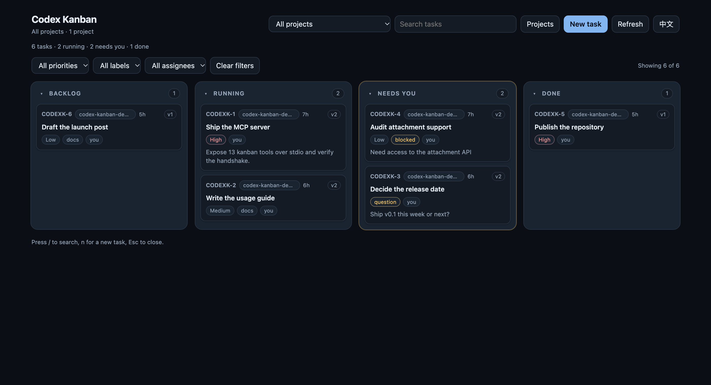
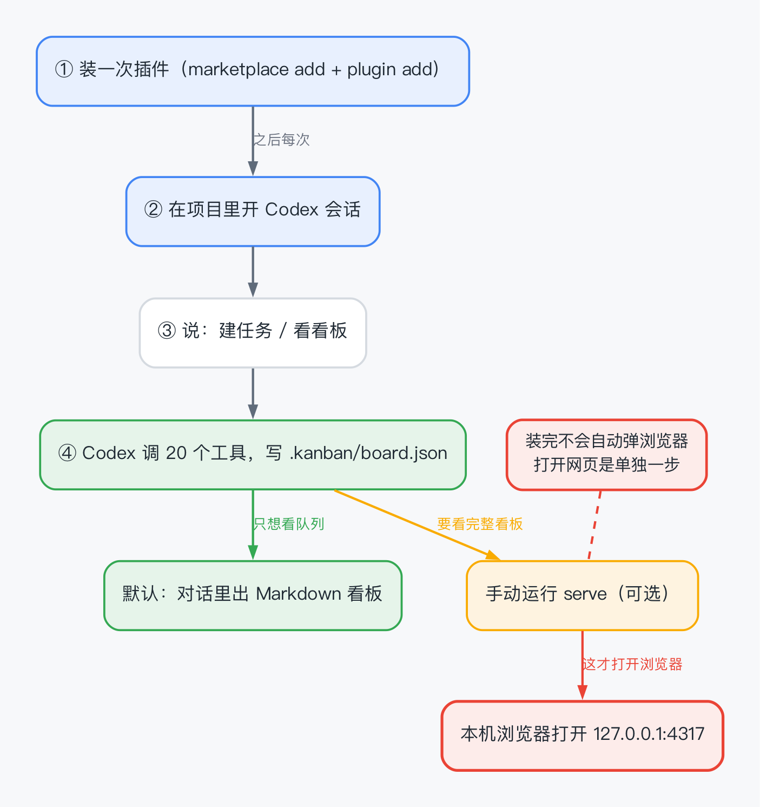
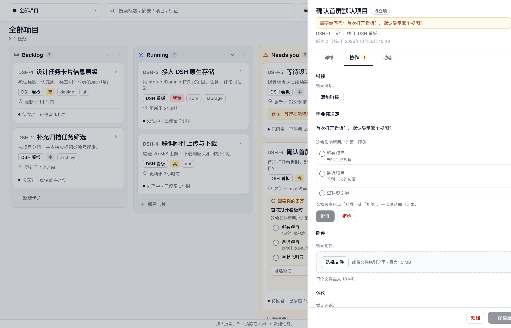
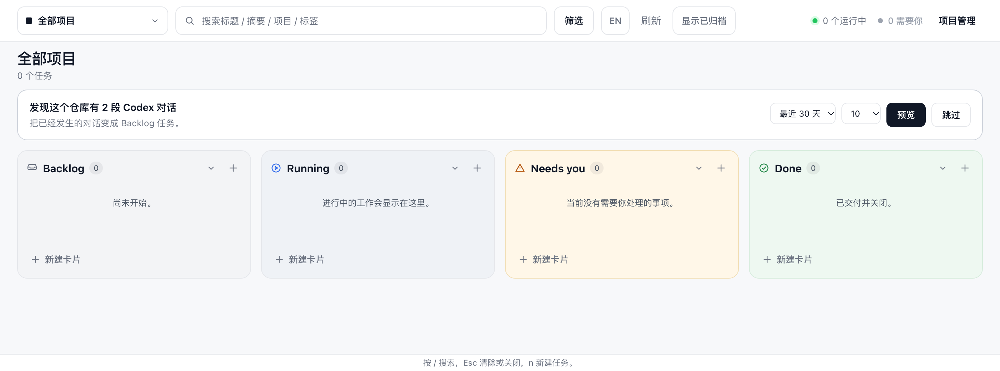
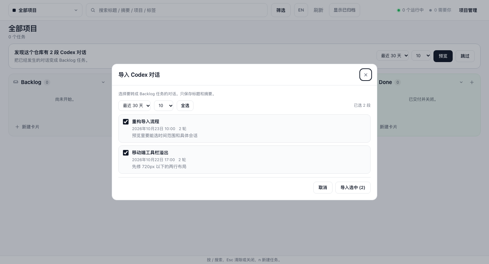
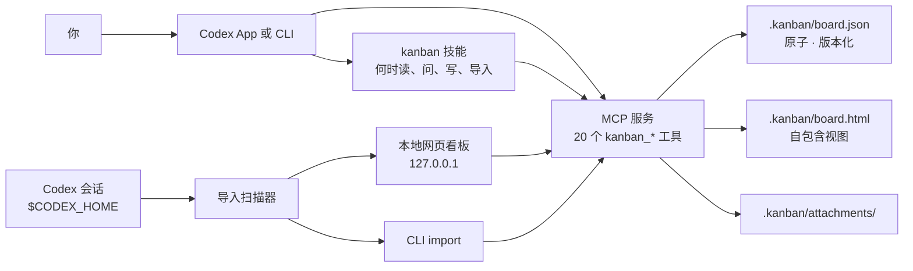

<p align="center">
  
</p>

<h1 align="center">Codex Kanban</h1>

<p align="center"><strong>Codex 原生任务看板：先把已经聊过的事导进来，再用项目、审批、阻塞和附件把仓库里的工作管起来。</strong></p>

<p align="center">
  <a href="https://github.com/SilasSolivagus/codex-kanban/actions/workflows/ci.yml"></a>
  
  
  
  <a href="LICENSE"></a>
</p>

<p align="center"><a href="README.md">English</a> · 简体中文</p>



Codex Kanban 给 Codex 补上一层不随对话消失的任务状态。任务、问题、阻塞、评论、活动记录
和附件都存在仓库内的 `.kanban/board.json`，重启后还在，能跟代码一起提交和评审，属于项目
本身而不是某一次聊天。

它也从你已经在做的事开始：首次使用时，可以把当前仓库已有的 Codex 对话整理成 Backlog
任务，写入前先给你勾选清单。Codex 通过 20 个 MCP 工具和一个 `kanban` 技能读写看板；
人则用本机网页看板或 CLI。没有托管服务、数据库、账号，也没有运行时依赖。

## 它能做什么

| | |
| --- | --- |
| **导入已有的工作** | 把当前仓库的 Codex 会话变成 Backlog 任务：先预览，可选时间范围（30/90 天/全部）和条数上限（10–100）。只读线程名和最后一条用户消息。 |
| **四列、六种状态** | Backlog（`backlog`、`todo`）、Running（`in_progress`）、Needs you（计算得出）、Done（`done`）。`in_review` 停在 Needs you；`canceled` 不显示。 |
| **Needs you 自动汇总** | 由未决问题、生效阻塞和待评审状态计算得出，优先级依次为问题、阻塞、评审。不能作为移动目标。 |
| **人类审批边界** | 批准和驳回必须带 `as: "user"` 与 `confirmed_by`；agent 不能把任务移出 `in_review`，也不能关掉自己提审的任务。 |
| **带选项的问题** | 2–5 个真实选项，每个可带说明。点一下选中，确认一次就记录答案并做决定。 |
| **阻塞只写一件事** | 缺权限、缺依赖、环境不可用、等别人的交付物时使用。卡片显示琥珀色“受阻”条，解除后离开 Needs you。 |
| **多项目** | 一个仓库多条工作流，各自独立的编号前缀与计数器，`APP-1` 与 `WEB-1` 可以共存。 |
| **归档与恢复** | 项目和任务都能归档。归档项目在领域层只读；归档任务默认隐藏，打开「显示已归档」才出现。 |
| **附件** | 从任务抽屉上传，存在 `.kanban/attachments/`，单文件 10 MB，可通过 HTTP 下载。 |
| **排序** | 跨列拖拽、列内拖拽排序，顺序写入 `sortOrder`。键盘：`Alt+↑/↓` 列内移动，`Alt+←/→` 跨列。 |
| **搜索与筛选** | 文本搜索，加优先级、标签、负责人筛选；可删除的胶囊 + `X / Y` 计数。 |
| **中英双语、键盘优先** | 中英文界面，`/` 搜索、`n` 新建、`Esc` 逐层关闭，支持减少动画。 |
| **可评审的持久状态** | 普通 JSON，原子写入、版本校验。跟代码一起提交，任务变更直接出现在 diff 里。 |

## 安装

前提：支持插件的 Codex，以及 Node.js 22 或更高版本。

```bash
codex plugin marketplace add https://github.com/SilasSolivagus/codex-kanban
codex plugin add codex-kanban@silassolivagus
```

本地开发目录也可以直接作为 marketplace：

```bash
codex plugin marketplace add /path/to/codex-kanban
codex plugin add codex-kanban@silassolivagus
```

以后更新：

```bash
codex plugin marketplace upgrade silassolivagus
codex plugin add codex-kanban@silassolivagus
```

然后在要跟踪的仓库里新开一个 Codex 会话。

## 三种用法



装插件不会自动打开浏览器。默认的看板出现在对话里；网页看板是单独的 `serve` 一步。

### 1. 在 Codex 里（agent 写，人做决定）

> “把 SSO 跳转这个 bug 建成高优先级任务，标签 auth。问我先修 staging 还是 production。”

Codex 建任务、带着选项提问，任务停在 Needs you。你回答后说“用 staging 方案，批准”，它记录
答案并带着你的确认关闭任务。任何时候问“现在什么在等我”，它只列 Needs you。

### 2. 本地网页看板（给人用）

```bash
# 从源码目录
node plugin/bin/codex-kanban.mjs serve

# 从已安装的插件（版本号可能不同）
node "$HOME/.codex/plugins/cache/silassolivagus/codex-kanban/0.7.2/bin/codex-kanban.mjs" serve
```

`serve` 默认打开 `http://127.0.0.1:4317`；加 `--no-open` 只打印地址。服务只监听回环，
没有账号体系，不发起外部请求。`--port` 换端口；`--host 0.0.0.0` 会暴露到局域网。



登录时自动启动：

| 系统 | 安装 | 卸载 |
| --- | --- | --- |
| macOS | `scripts/install-autostart.sh --root "$PWD"` | `scripts/uninstall-autostart.sh` |
| Linux | `scripts/install-autostart-linux.sh --root "$PWD"` | `scripts/uninstall-autostart-linux.sh` |
| Windows | `powershell -File scripts\install-autostart-windows.ps1 -Root .` | `powershell -File scripts\uninstall-autostart-windows.ps1` |

加 `--open`（macOS/Linux）或 `-Open`（Windows）可在登录时同时打开浏览器。

### 3. CLI（给脚本用）

```bash
node plugin/bin/codex-kanban.mjs board
node plugin/bin/codex-kanban.mjs add "修复登录跳转" \
  --description "SSO 后落到首页，没有回到来源页。" \
  --priority high --label auth
node plugin/bin/codex-kanban.mjs move 1 --to in_progress
node plugin/bin/codex-kanban.mjs ask 1 \
  --prompt "先修哪个环境？" \
  --option Staging --option Production
node plugin/bin/codex-kanban.mjs approve 1 --confirmed-by "先上 staging"
node plugin/bin/codex-kanban.mjs render --open
```

数字引用（如 `1`）会解析成 `<前缀>-1`。`--root PATH` 指向别的仓库；默认使用当前目录
向上最近的、包含 `.git` 或 `.kanban` 的目录。

## 导入历史

新看板不必从空白开始。

- **网页**：空板时提议导入当前仓库的 Codex 会话，可选时间范围（30 天 / 90 天 / 全部）和
  条数上限（10–100），并给出勾选清单。确认之前不写任何数据。
- **Codex 对话**：空板时 `kanban` 技能会问同样的问题，并先给标题预览。
- **CLI**：默认只预览，显式 `--apply` 才创建。





```bash
# 只预览
node plugin/bin/codex-kanban.mjs import --root "$PWD" --since 30d

# 确认后创建
node plugin/bin/codex-kanban.mjs import --root "$PWD" --since 30d --apply
```

规则：只取 `cwd` 在当前仓库内的会话；至少两轮对话；只读线程名和最后一条用户消息；导入
任务进 Backlog，带 `imported` 标签和指向会话的 `source`；标题重复会跳过。「跳过」按仓库
记忆，**项目管理 → 导入历史** 可重新打开。

## 工具

所有工具都要传 `root`（仓库绝对路径）。除非设置了 `CODEX_KANBAN_ROOT`，否则它是必填的；
这里故意不回退到服务进程的工作目录，因为安装后的插件从插件缓存启动。写已有任务要带
`kanban_task_get` 返回的当前 `version`；批准和驳回还需要 `as: "user"` 与 `confirmed_by`。

| 工具 | 作用 |
| --- | --- |
| `kanban_board` | 渲染 Markdown 看板，Needs you 优先，可按项目或列过滤。 |
| `kanban_task_get` | 读取单个任务：描述、问题、阻塞、链接、附件、评论、活动、当前版本。 |
| `kanban_task_create` | 在指定项目里建任务，默认 Backlog。 |
| `kanban_task_update` | 修改标题、描述、优先级、标签、链接。 |
| `kanban_task_move` | 跨列/状态移动，或调整列内顺序。 |
| `kanban_task_block` | 记录一条可执行的阻塞原因。 |
| `kanban_task_unblock` | 解除阻塞。 |
| `kanban_task_ask` | 提一个 2–5 个选项的问题。 |
| `kanban_task_answer` | 记录所选选项和备注。 |
| `kanban_task_approve` | 仅人类：批准并关闭为 Done。 |
| `kanban_task_reject` | 仅人类：带备注驳回，回到 Backlog。 |
| `kanban_task_comment` | 追加评论，跟着任务走。 |
| `kanban_task_archive` | 归档任务，从看板隐藏但不删除。 |
| `kanban_task_restore` | 恢复归档任务。 |
| `kanban_render` | 写出 `.kanban/board.html`，返回路径和内联引用。 |
| `kanban_project_list` | 列出项目、前缀、归档状态和任务数。 |
| `kanban_project_create` | 新建项目，可指定前缀和工作区路径。 |
| `kanban_project_update` | 重命名项目、改前缀或工作区路径。 |
| `kanban_project_archive` | 归档项目，任务转为只读。 |
| `kanban_project_restore` | 恢复归档项目。 |

## 项目、归档与附件

- 项目是仓库内的工作流，编号在项目内唯一，不是仓库内唯一。
- 归档在领域层强制生效：归档项目里的任务写入返回 `PROJECT_ARCHIVED`，归档任务返回
  `TASK_ARCHIVED`。
- 附件是 `.kanban/attachments/<id>` 下的文件，元数据挂在任务上。不想把二进制提交进 git，
  就把附件目录加入 `.gitignore`。
- Needs you、受阻、待审都是从状态计算出来的覆盖层，不会改写底层状态。

## 架构



技能负责策略：回答前先读板、缺人类决定时提问、绝不自己批准自己、空板时提议导入。服务
负责数据路径：一个仓库一块板，所有写入走同一个存储。导入扫描器只读会话标题和最后一条
用户消息。

## 数据模型

首次写入时创建，schema 2：

```json
{
  "schema": 2,
  "projects": [
    {
      "id": "prj_default",
      "name": "my-app",
      "prefix": "MYAPP",
      "workspacePath": null,
      "nextTaskNumber": 2,
      "archivedAt": null,
      "createdAt": "2026-10-22T07:45:38.341Z",
      "updatedAt": "2026-10-22T07:45:38.341Z"
    }
  ],
  "tasks": [
    {
      "id": "tsk_8116bbc1-7390-4031-9c1f-719fd79c6f3b",
      "projectId": "prj_default",
      "identifier": "MYAPP-1",
      "title": "修复登录跳转",
      "status": "in_progress",
      "priority": "high",
      "labels": ["auth"],
      "blockedReason": null,
      "pendingQuestion": null,
      "links": [],
      "attachments": [],
      "comments": [],
      "activity": [],
      "archivedAt": null,
      "version": 3,
      "createdAt": "2026-10-22T07:45:38.342Z",
      "updatedAt": "2026-10-22T07:46:12.000Z"
    }
  ]
}
```

导入的任务额外带 `source: {kind:"session", id, title}`。v1 的板子会在首次读取时就地迁移。
`version` 从 1 开始，每次变更递增；写入必须带读到的版本，旧版本返回
`TASK_VERSION_CONFLICT`，缺版本返回 `VERSION_REQUIRED`。写入通过 `.kanban/board.lock`
串行化，流程是写 `board.json.tmp`、落盘、再重命名。

## UX 质量

网页看板经过两轮独立设计走查，对照 dsh-kanban 参考图，带截图和 goodwill 表：

| 轮次 | 设计评分 | AI Slop | Goodwill | 结论 |
| --- | --- | --- | --- | --- |
| 第一轮 | C（2.80/4） | B | 43/100 | 10 项问题 |
| 第二轮 | **B（3.42/4）** | B | **90/100** | 9/10 修复，无回归 |

报告、截图和剩余问题都在 [`docs/ux-review/`](docs/ux-review/)。界面支持键盘操作、可见焦点、
`prefers-reduced-motion`，元数据对比度不低于 4.83:1。

## 已知限制

- **导入是启发式，不是总结。** 只取线程名和最后一条用户消息；一段长对话会变成一条
  Backlog 任务，也不会判断“是否已完成”。导入后需要人分诊。
- **审批边界是协作约定，不是身份认证。** `as: "user"` 和 `confirmed_by` 都是调用方
  声明；刻意撒谎、跑 CLI 或手改 `board.json` 都能绕过。真正的保护是评审 diff。
- **没有实时协作。** 两个人用同一块板靠 git；网页服务单用户、只监听回环。
- **一个仓库一块板。** 项目是仓库内的工作流，不是跨仓库全局看板。
- **App 内联视图没有端到端验证。** `kanban_render` 会写 HTML 并返回宿主引用，但各客户端
  里真正验证过的是 Markdown 看板。
- **规模未验证。** 筛选和渲染只在几十条任务上试过，没到几百条。

## 路线图

- 跨仓库的全局看板，同时保留“每仓库一个文件”的退路。
- 把人类确认和审批一起持久化，让审计记录带上原话。
- 多人感知（谁在看、软锁），但不把看板变成服务。
- 可选的模型辅助导入：把一段会话总结成多条任务。

## 开发

```bash
git clone https://github.com/SilasSolivagus/codex-kanban.git
cd codex-kanban
node --test
```

`v0.7.2` 共 296 项测试，只用 `node:test`，没有任何依赖需要安装。`npm test` 跑同一条命令。

```
.agents/plugins/marketplace.json   本地 marketplace 入口
plugin/.codex-plugin/plugin.json   插件清单
plugin/.mcp.json                   MCP 服务配置
plugin/bin/                        启动器与 CLI
plugin/server/                     JSON-RPC stdio 服务、HTTP API
plugin/src/                        领域、存储、规则、渲染、会话扫描、网页界面
plugin/skills/kanban/SKILL.md      agent 工作流
test/                              node:test 测试
scripts/                           自启安装脚本（macOS/Linux/Windows）
docs/ux-review/                    走查报告、证据与分批报告
```

见 [CONTRIBUTING.md](CONTRIBUTING.md)，以及给人看的使用说明：
[English](docs/usage.en.md) · [简体中文](docs/usage.md)。

## 许可证

MIT © 2026 Silas Solivagus，见 [LICENSE](LICENSE)。
