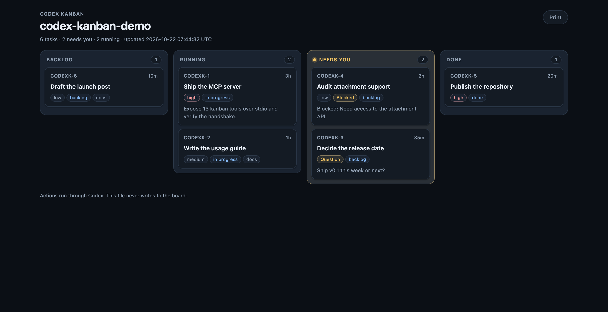
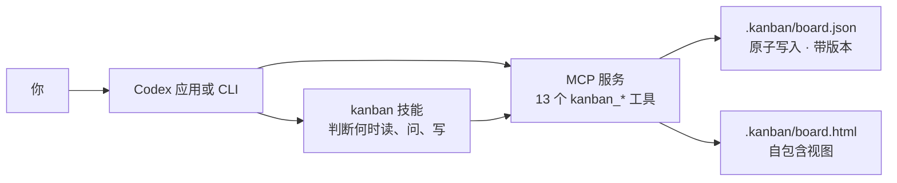

<p align="center">
  
</p>

<h1 align="center">Codex Kanban</h1>

<p align="center"><strong>为 Codex 打造的任务看板：四列视图、审批、阻塞项，以及随仓库持久化的状态。</strong></p>

<p align="center">
  <a href="https://github.com/SilasSolivagus/codex-kanban/actions/workflows/ci.yml"></a>
  <a href="https://github.com/SilasSolivagus/codex-kanban"></a>
  
  <a href="LICENSE"></a>
</p>

<p align="center"><a href="README.md">English</a> · 简体中文</p>



Codex Kanban 给 Codex 补上一层不随对话消失的任务状态。任务存放在仓库内的
`.kanban/board.json`，重启后还在，能跟着代码一起提交和评审，属于项目本身而不是某一次
聊天。Codex 通过 13 个 MCP 工具和一个轻量的 `kanban` 技能读写看板，由技能判断什么时候
该建任务、什么时候该阻塞、什么时候该交给人类决定。

不需要托管服务、数据库或任何运行时依赖。看板就是一个 JSON 文件；Markdown 是主要视图，
HTML 看板是附加的自包含视图，需要纵览整条队列时再用。

## 功能

| | |
| --- | --- |
| **四列，六种状态** | Backlog（`backlog`、`todo`）、Running（`in_progress`）、Needs you（计算得出）、Done（`done`）。`in_review` 也会停在 Needs you；`canceled` 不显示在看板上。 |
| **Needs you 自动汇总** | 这一列由未决问题、生效中的阻塞和待评审状态计算得出，优先级依次为问题、阻塞、评审。它不能作为移动目标。 |
| **人类审批边界** | `kanban_task_approve` 和 `kanban_task_reject` 必须带 `as: "user"` 和 `confirmed_by`；智能体不能把 `in_review` 任务直接移到 Done。 |
| **带选项的问题** | 提问时给出 2 到 5 个真实选项。回答会被记录，但任务仍留在 Needs you，直到人类批准或驳回。 |
| **阻塞项只写一件事** | 缺权限、缺依赖、环境不可用、等别人的交付物时使用阻塞。解除后任务回到原来的列。 |
| **状态持久且可评审** | 仓库里的普通 JSON 文件，跟代码一起提交，任务变更可以直接出现在 diff 里。 |
| **原子写入与版本校验** | 每次看板写入都经过锁、临时文件和原子重命名；任务更新必须带版本，旧版本写入会返回 `TASK_VERSION_CONFLICT`。 |
| **多项目** | 一个仓库可以有多条工作流，各自独立的编号前缀与计数器；归档后只读，可恢复。 |
| **附件** | 文件存在 `.kanban/attachments/`，从网页上传，单文件 10 MB。 |
| **搜索与筛选** | 文本搜索，加上优先级、标签、负责人筛选；列可折叠。 |
| **两种展示方式** | 终端和对话里用 Markdown；需要看整体时生成自包含的 HTML 看板。 |
| **零运行时依赖** | 只需要 Node.js 22 或更高版本，ESM，无构建步骤，无需安装依赖。 |

## 安装

前提：支持插件的 Codex，以及 Node.js 22 或更高版本。

从仓库市场安装：

```bash
codex plugin marketplace add https://github.com/SilasSolivagus/codex-kanban
codex plugin add codex-kanban@silassolivagus
```

本地检出则把市场指向目录：

```bash
codex plugin marketplace add /path/to/codex-kanban
codex plugin add codex-kanban@silassolivagus
```

在要跟踪的仓库里重新打开一个 Codex 会话。插件会加载 `kanban` 技能，MCP 服务同时提供
下面 13 个工具。

## 用法

下面三个提示覆盖主要流程。

**先看看有什么在等人处理。**

> “现在有什么需要我处理？只看 Needs you 这一列。”

Codex 读取看板，返回需要关注的队列，其余内容不打扰你。

**把需要跨对话保留的工作记下来。**

> “把 SSO 跳转这个 bug 记成高优先级任务，加 `auth` 标签。顺便问我一句：先修 staging
> 还是 production？”

Codex 建任务、挂上一个带选项的问题，然后把它留在 Needs you。

**人类做完决定后收尾。**

> “发布说明我批准了，选 staging 方案。把那个任务按我的批准关掉，然后把看板渲染出来。”

Codex 记录答案、带上人类的确认完成审批、把任务移到 Done，并写出
`.kanban/board.html`。

## 工具

每个工具都要带 `root`（仓库绝对路径）。除非设置了 `CODEX_KANBAN_ROOT` 环境变量，否则
它是必填的；这里故意不回退到服务进程的工作目录，因为安装后的插件是从插件缓存目录启动的。
写任务时要带 `kanban_task_get` 返回的当前 `version`；approve 和 reject 还需要
`as: "user"` 和 `confirmed_by`。

| 工具 | 作用 |
| --- | --- |
| `kanban_board` | 输出 Markdown 看板，Needs you 在前，可只看一列或隐藏 Done。 |
| `kanban_task_get` | 读取单个任务：描述、问题、阻塞、链接、评论、活动记录和当前版本。 |
| `kanban_task_create` | 在 Backlog 或指定状态创建任务，返回任务标识。 |
| `kanban_task_update` | 修改标题、描述、优先级、标签或链接，不移动任务。 |
| `kanban_task_move` | 移到某一列或存储状态；Needs you 不能手动选择。 |
| `kanban_task_block` | 记录一条可执行的阻塞原因，任务进入 Needs you。 |
| `kanban_task_unblock` | 清除阻塞，任务回到原来的列。 |
| `kanban_task_ask` | 挂出带 2 到 5 个选项的问题，任务进入 Needs you。 |
| `kanban_task_answer` | 记录选项和备注，不关闭问题。 |
| `kanban_task_approve` | 仅限人类：批准并把任务置为 Done。 |
| `kanban_task_reject` | 仅限人类：驳回并附备注，任务回到 Backlog。 |
| `kanban_task_comment` | 追加一条跟随任务的评论。 |
| `kanban_render` | 写出 `.kanban/board.html`，返回路径和内联视觉引用。 |

## 本地 Web 看板

不想在终端或对话里操作时，可以直接开一个本地看板：

```bash
node plugin/bin/codex-kanban.mjs serve --open
# Codex Kanban · http://127.0.0.1:4317
```


读写的是同一个 `.kanban/board.json`。卡片可在 Backlog、Running、Done 之间拖拽；
点开卡片可以回答问题、批准、驳回、阻塞、解阻塞、提问或评论。Needs you 不能作为拖拽目标。

服务默认只监听 `127.0.0.1`，没有账号体系，也不发起任何外部请求。`--port` 换端口；
`--host 0.0.0.0` 会把看板暴露到局域网，只应在你信任的机器上使用。

## 项目、归档与附件

一块看板可以容纳多个项目。每个项目有自己的编号前缀与计数器，所以同一个仓库里可以同时有
`APP-1` 和 `WEB-1`。

- 列内可以拖拽排序，顺序存在 `sortOrder` 里。
- 任务也能单独归档：归档后默认隐藏，打开 **显示已归档** 才能看到，写入返回 `TASK_ARCHIVED`。
- 在网页看板的 **项目管理** 里新建、重命名、归档、恢复，或使用 `kanban_project_*` 工具。
- 归档在领域层强制生效：归档项目下的任何任务写入都会返回 `PROJECT_ARCHIVED`，直到恢复。
- 附件存在 `.kanban/attachments/<id>`，元数据挂在任务上。抽屉里上传（单文件 10 MB），
  下载就是 `GET /api/attachments/<id>`。不想把二进制提交进 git，就把
  `.kanban/attachments/` 加进 `.gitignore`。

## 架构



技能负责策略：回答前先读看板，缺人类决定时提问而不是阻塞，不批准自己做的任务。MCP
服务负责数据通路：一个仓库一块看板，所有读写都走同一个存储。HTML 文件不会反向写入。

## 命令行

CLI 不经过 Codex，直接操作同一份存储。在仓库根目录：

```bash
node plugin/bin/codex-kanban.mjs board
node plugin/bin/codex-kanban.mjs add "修复登录跳转" \
  --description "SSO 登录后总是落在 /，应回到进入登录前的页面。" \
  --priority high --label auth
node plugin/bin/codex-kanban.mjs move 1 --to in_progress
node plugin/bin/codex-kanban.mjs ask 1 \
  --prompt "先在哪套环境修复？" \
  --option Staging \
  --option Production
node plugin/bin/codex-kanban.mjs answer 1 --option opt_1
node plugin/bin/codex-kanban.mjs approve 1 --confirmed-by "先上 staging"
node plugin/bin/codex-kanban.mjs render --open
```

- 数字引用（如 `1`）会解析为 `<项目前缀>-1`。
- `--root PATH` 指向其他仓库。默认从当前目录开始向上查找，使用第一个包含 `.git` 或
  `.kanban` 的目录。
- CLI 默认以人类身份运行。`approve` 和 `reject` 始终以人类身份执行，并且必须提供
  `--confirmed-by`。
- 安装插件后，入口位于
  `$CODEX_HOME/plugins/cache/silassolivagus/codex-kanban/<version>/bin/codex-kanban.mjs`。
  使用默认 Codex 主目录和 0.1.0 版本时：

```bash
node "$HOME/.codex/plugins/cache/silassolivagus/codex-kanban/0.1.0/bin/codex-kanban.mjs" board --root "$PWD"
```

## 数据模型

第一次写入时才会创建看板：

```json
{
  "schema": 1,
  "project": { "name": "my-app", "prefix": "MYAPP", "createdAt": "2026-10-22T07:45:38.341Z" },
  "nextTaskNumber": 2,
  "tasks": [
    {
      "id": "tsk_8116bbc1-7390-4031-9c1f-719fd79c6f3b",
      "identifier": "MYAPP-1",
      "title": "修复登录跳转",
      "status": "in_progress",
      "priority": "high",
      "labels": ["auth"],
      "blockedReason": null,
      "pendingQuestion": null,
      "version": 3,
      "createdAt": "2026-10-22T07:45:38.342Z",
      "updatedAt": "2026-10-22T07:46:12.000Z"
    }
  ]
}
```

`version` 从 1 开始，任务每发生一次变更就加一。写入时必须带上读取到的版本：版本过期返回
`TASK_VERSION_CONFLICT`，完全没带则返回 `VERSION_REQUIRED`，调用方需要重新读取。
写入通过 `.kanban/board.lock` 串行化，先写 `board.json.tmp` 并同步到磁盘，再重命名
覆盖 `board.json`。

## 已知限制

- **审批边界是协作约定，不是身份认证。** `as: "user"` 和 `confirmed_by` 是由工具和技能执行的声明；刻意撒谎、直接运行 CLI 或手改 `board.json` 都能绕过。真正的保护是看板本身就是可评审的普通 JSON。
- **`confirmed_by` 只是门槛，不是审计字段。** 审批和驳回必须提供它，但它不会作为独立
  字段保存。解决记录和活动日志能证明“做过决定”，如果需要保留原话，请写进备注。
- **HTML 看板只读，且依赖宿主。** 按钮通过 `window.openai.sendFollowUpMessage` 把动作
  交回 Codex。在 Codex 应用里会发出后续消息；在普通浏览器里仍可阅读，但按钮无法写入，
  界面会明确提示。
- **已取消的任务不显示在看板上。** 移到 `canceled` 后任务仍保留在 `board.json`，也能按
  标识读取，但不再出现在任何一列。

## 路线图

- 审批时持久化人类的确认内容，让审计记录包含原话，而不只是“已批准”。
- 为规模变大的看板增加搜索和筛选。
- 收集 v0.1 反馈后再评估附件和多仓库看板。

## 开发

```bash
git clone https://github.com/SilasSolivagus/codex-kanban.git
cd codex-kanban
node --test
```

`v0.3.0` 共有 213 项测试，只使用 `node:test`。`npm test` 执行同一条命令，没有运行时
或开发依赖需要安装。

```
.agents/plugins/marketplace.json   本地市场条目
plugin/.codex-plugin/plugin.json   插件清单
plugin/.mcp.json                   MCP 服务配置
plugin/bin/                        启动器和 CLI
plugin/server/                     JSON-RPC stdio 服务
plugin/src/                        领域逻辑、存储、规则、渲染
plugin/skills/kanban/SKILL.md      面向智能体的工作流
test/                              node:test 测试
```

插件隔离调试流程见 [CONTRIBUTING.md](CONTRIBUTING.md)。人类侧的操作说明见
[使用指南](docs/usage.md)。

## 许可证

MIT © 2026 Silas Solivagus。见 [LICENSE](LICENSE)。
