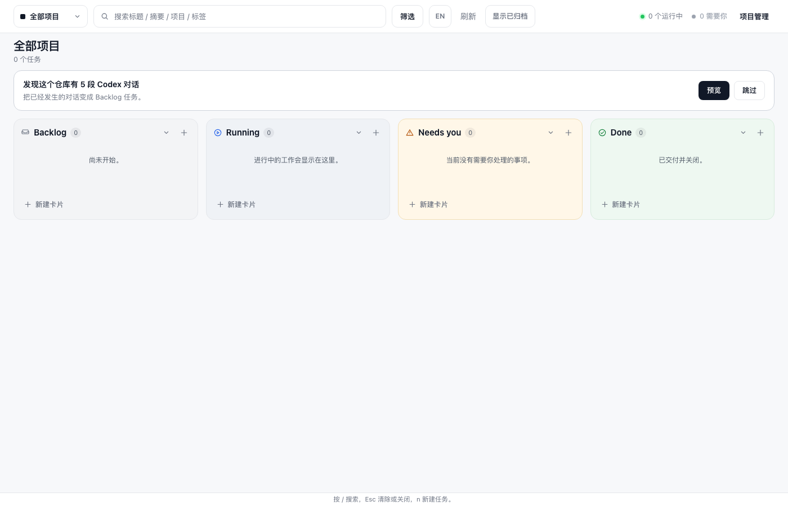
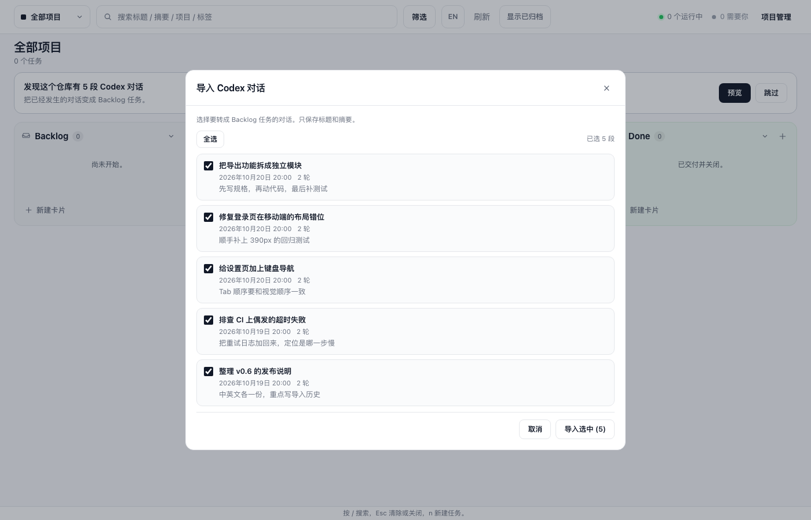
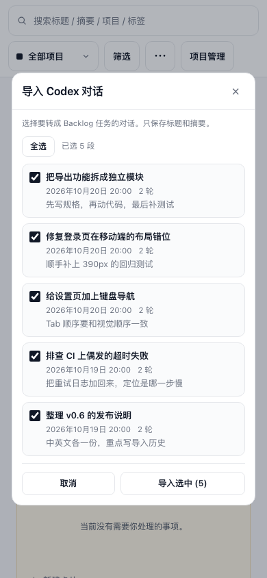
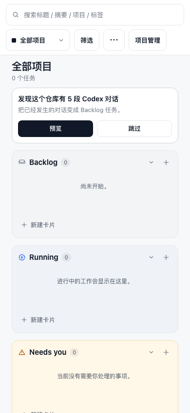

# Import existing Codex sessions

**Date** · 2026-10-23
**Scope** · Codex Kanban v0.6.5 → session import across CLI, Web onboarding and the kanban skill
**Files changed** · `plugin/src/sessions.mjs` (new), `plugin/src/import.mjs` (new), `plugin/src/domain.mjs`, `plugin/bin/codex-kanban.mjs`, `plugin/server/web.mjs`, `plugin/src/livehtml.mjs`, `plugin/skills/kanban/SKILL.md`, tests and evidence
**Tests** · 293 passing (`node --test`), up from 274
**Commit** · `feat: import existing codex sessions into the board`

## What shipped

### 1 · Read-only scanner

`plugin/src/sessions.mjs` exports `scanSessions({root, sinceDays, limit, codexHome})`.
It resolves `codexHome` from the argument, `CODEX_HOME`, or `~/.codex`, then:

- reads `session_index.jsonl` for `thread_name` and `updated_at`, tolerating a
  missing file, malformed lines and unknown ids;
- walks `sessions/**/rollout-*.jsonl` and skips files whose mtime is older than
  `sinceDays` before reading them;
- reads only the first line for `session_meta` (`id`, `cwd`, `timestamp`) and
  keeps sessions whose `cwd` is the repository root or inside it, using
  `path.relative` containment rather than a string prefix;
- streams the remaining lines for user turns. `event_msg`/`user_message` wins
  over the duplicated `response_item` copy of the same turn; response-item
  content arrays are the fallback for older rollouts;
- drops sessions with fewer than two user turns and caps title at 80 and
  summary at 200 characters, one line each;
- deduplicates by normalized title (NFKC, lowercase, punctuation stripped),
  keeps the newest, sorts by `updatedAt` descending and caps at `limit`
  (default 10).

Candidates contain only `{id, title, summary, cwd, updatedAt, userTurns, path}`.
No other conversation content leaves the scanner.

### 2 · CLI

```text
codex-kanban import [--root PATH] [--since 30d] [--limit 10] [--project ID|NAME] [--apply] [--json]
```

The default is a dry run that prints:

```text
# | date | turns | title | summary
1  | 2026-10-20 | 2     | 把导出功能拆成独立模块 | 先写规格，再动代码，最后补测试
2  | 2026-10-20 | 2     | 修复登录页在移动端的布局错位 | 顺手补上 390px 的回归测试
5 candidates; re-run with --apply to create them
```

`--apply` creates each candidate in Backlog with `labels: ["imported"]`,
`description` = summary and `source: {kind:"session", id, title}`. It does not
write on a dry run or when the normalized title already exists on the board.
`--json` returns `{ok, candidates}` for a dry run and
`{ok, created:[{identifier,title}], skipped:[{id,title,reason}]}` for an apply.
`--since` accepts `30d`/`7d`/`90d` or an ISO date; anything else exits 1 with
`INVALID_INPUT`.

### 3 · Domain and API

- `createTask` accepts an optional `source` object, validates
  `{kind:"session", id, title}` and persists it additively. Existing boards need
  no migration and tasks without a source omit the field.
- `GET /api/import/candidates?since=30d&limit=10` returns `{ok, candidates}` from
  the scanner for the server's board root.
- The `import.apply` action accepts `{sessionIds, projectId?}`, re-scans, maps
  the ids, creates tasks through the same shared helper as the CLI, and returns
  the fresh board payload plus `created` and `skipped`. `task.create`,
  `task.update` and every existing route keep their shape.

### 4 · Web onboarding

When every project has zero tasks (active and archived) and the browser has not
skipped the offer, an onboarding card appears above the columns:

```text
发现这个仓库有 5 段 Codex 对话
把已经发生的对话变成 Backlog 任务。          [预览] [跳过]
```

`预览` opens a modal with one checkbox row per candidate (title, localized date,
turn count, capped summary), `全选`, `取消` and `导入选中 (k)`. The apply action
posts selected ids and, when a specific project is selected, its `projectId`.
`跳过` writes `codex-kanban.importSkipped=1` and hides the card across reloads;
`项目管理 → 导入历史` reopens the importer after a skip or after the board has
tasks. The card is not rendered when the scan returns no candidates.

At 390px the card stacks its actions full width and the dialog uses
`calc(100vw - 16px)`; rows stay `auto minmax(0, 1fr)` with `min-width: 0` and
`overflow-wrap: anywhere`. There are no external requests.

### 5 · Skill

`plugin/skills/kanban/SKILL.md` now has a **First run** section: when the board is
empty, preview with `codex-kanban import`, show the candidate titles, and create
only after an explicit yes with `--apply`. It also warns against importing
sessions from another repository and points to the web importer.

## Verification

`node --test` → **293 tests, 293 pass, 0 fail** (19 new tests across
`sessions`, CLI, domain, web API and web UI).

Chrome headless over CDP against the restarted server on
`http://127.0.0.1:4399`, with the demo repository
`/tmp/codex-kanban-import-demo/repo` and a temp `CODEX_HOME`
(`/tmp/codex-kanban-import-demo/codex`) holding five sessions inside the root
and one outside it:






Measured in the same run:

| Check | Result |
| --- | --- |
| Onboarding text | `发现这个仓库有 5 段 Codex 对话` |
| Modal rows / checked | 5 / 5, `已导入 5 段` → `导入选中 (5)` |
| Modal width at 1400 / 390 | 760px / 356px |
| Document scroll width at 390 | 390px (no horizontal overflow) |
| Row overflow at 390 | 0 of 5 |
| Skip persistence after reload | `codex-kanban.importSkipped=1`, card hidden, 0 cards |
| Project menu | `导入历史` present, reopens the importer and closes the project dialog |
| Import through UI | 5 Backlog cards, toast `已导入 5 段对话到 Backlog。`, every card labelled `imported` |
| Network resources | `/api/board`, `/api/import/candidates`, `/api/action`; 0 external |

## Safety

- The scanner never writes and never returns conversation body text beyond the
  capped title and summary; candidates expose only the fields listed above.
- Import is opt-in: dry run by default, no writes from a preview, and the CLI
  requires `--apply`.
- The only writes are ordinary task creations under `<repo>/.kanban/board.json`.
- Imported tasks carry the `imported` label and a `source` pointer, so a human
  can audit what came from a session in the JSON diff.

## Remaining issues

- The web offer scans a fixed 30-day window and caps the list at 10 candidates.
  Older or larger imports are available through the CLI's `--since` and
  `--limit` (up to 100).
- Imported descriptions are the capped 200-character last user message, not a
  generated summary; there are no model calls anywhere in the feature.
- The skip flag is stored per browser origin, not per repository, so switching
  between boards served from the same origin shares the preference.
- `source` is persisted and visible in `board.json`, but there is no editor for
  it in the drawer; editing it would be a separate feature.
