# Codex Kanban — UX & Design Audit

**Target** · http://127.0.0.1:4317 (demo board: 8 tasks, 2 projects, zh default)
**Date** · 2026-10-23
**Reviewer stance** · Senior product designer; rendered UI only, not implementation.
**Reference** · `dsh-kanban/docs/assets/kanban-board.png` and `kanban-drawer.png`

**Headline scores**

| Design Score | AI Slop Score | Goodwill |
| --- | --- | --- |
| **C** (2.80 / 4.0 weighted, 70%) | **B** | **43 / 100 — needs work** |

> **Verdict** — A calm, well-composed desktop kanban with a genuinely good inline-approval idea, rendered one size too small and abandoned at phone width; it reads as a strong desktop prototype, not a shipped product.

---

## 1. First impression, before touching anything

At 1400×900 the page lands as four pale lanes. The sequence is instantly legible — Backlog → Running → Needs you → Done — and the amber *Needs you* lane is the only warm surface on the page, so my eye goes there before I have read a word. The inline question on DSH-6 is the best thing on the screen: I can see the question, the options and the approve button without opening anything. That is real product thinking.

Then I lean in. The card titles are 14.5px, the chips 11px, the metadata 12px, and the cards sit 8px apart. The board reads at roughly 85% of the reference's scale. The reference feels like a paper planning wall; this feels like a compressed admin table with rounded corners. The structure is better than the surface.

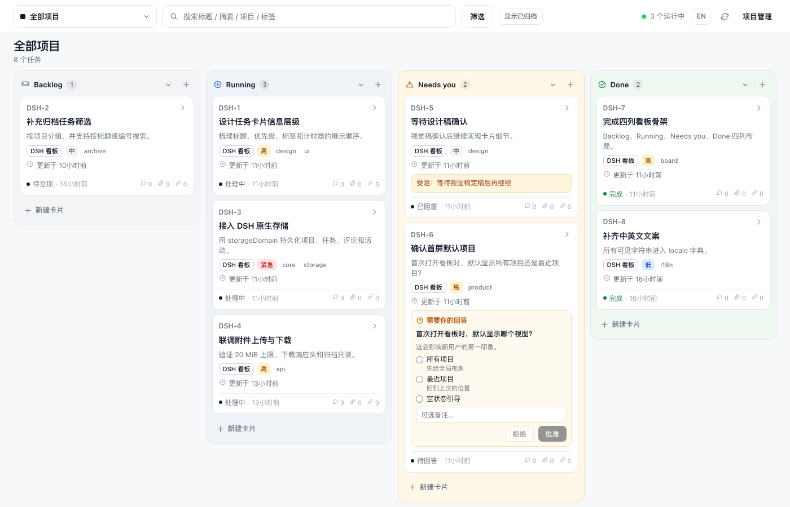

What I can see without interaction:

- 8 tasks, 4 lanes, 2 in Needs you, 3 running.
- The project selector is the only thing identifying context; the page never says "Codex Kanban".
- The question card is visibly taller and warmer than everything else — a good anchor.
- The footer shortcut hint is clipped at 900px (`按 / 搜索，n 新建任务，Esc 关闭。` starts at y=892).

---

## 2. Scorecard

Category grades follow the review rubric (A–F); the weighted score uses A=4, B=3, C=2, D=1.

| Category | Weight | Grade | Why |
| --- | --- | --- | --- |
| Visual hierarchy | 15% | **B** | The amber Needs-you lane is a strong anchor, but the drawer has no hierarchy at all (one 1,638px form) and the header does not surface the human-action count. |
| Typography | 15% | **B** | Consistent family and weights, but the whole scale is one step below the reference; card title (14.5px) is barely above body and column header (13px) is smaller than the cards it labels. |
| Spacing & layout | 15% | **B** | Regular grid, but 11px card padding / 8px card gaps / 10px lane gaps are roughly half the reference's air. |
| Color & contrast | 10% | **B** | Palette is coherent and restrained; the smallest metadata (2.54:1) fails AA and the empty-state copy is borderline (4.4:1). |
| Interaction states | 10% | **C** | Inline approval and focus rings are good; filter state is invisible, status is a fake radio, drawer question radios are misaligned, and the `/ → Esc → n` chain breaks. |
| Responsive | 10% | **C** | Lanes stack cleanly, but the toolbar is 854px wide at a 390px viewport, and 1024px clips every status label. |
| Content quality | 10% | **B** | Empty-project copy is genuinely good; filtered-empty copy is repeated four times, activity is raw English event text, and relative times contradict each other. |
| AI Slop | 5% | **B** | No purple gradients, no 3-column feature grid, no emoji, cards are the interaction. Still: system stack, native controls, uniform 10–12px radii, rows of tiny grey metadata. |
| Motion | 5% | **C** | Drawer/backdrop 140ms; otherwise no motion. Cards teleport between lanes after approval and the toast is the only change cue. |
| Performance feel | 5% | **A** | DOMContentLoaded 12.6ms, load 17ms, 138KB document on localhost; every interaction feels immediate. |

**Weighted Design Score: 2.80 / 4.00 = C.** Desktop alone is a B−; the phone and the drawer pull it down.

**AI Slop Score: B.** It does not look generated by a template — it has a point of view. It does look *unfinished* in the places where the browser's own controls show through.

---

## 3. Litmus checks

| Check | Answer | Note |
| --- | --- | --- |
| Brand/product unmistakable in first screen? | **NO** | No wordmark, no product name in the page; the black square reads as a project mark. The browser tab is the only place "Codex Kanban" appears. |
| One strong visual anchor? | **YES** | The amber *Needs you* lane and the inline question panel; the eye lands there after the H1. |
| Understandable by scanning? | **YES** | Four labelled lanes, counts, chips and status dots are enough to orient in ~3 seconds. The 11px metadata is not required to understand the board. |
| Each section has one job? | **NO** | The board does; the drawer does not — "属性" contains links, a question, attachments, comments and activity. |
| Are cards actually necessary? | **YES** | The card is the unit of interaction; this is a kanban, not a card-grid decoration. |
| Does motion improve hierarchy? | **NO** | There is almost none, and card movement between lanes has no transition at all. |
| Would it feel premium with all decorative shadows removed? | **YES** | It is already shadowless; borders and tinted lanes carry the design. The missing premium is type scale and spacing, not shadows. |

---

## 4. Goodwill meter

Start: **70**. Deltas are per step, in the order I walked the product.

| # | Step | Δ | Score | What moved it |
| --- | --- | --- | --- | --- |
| 1 | First impression (1400) | **−1** | 69 | +2 clear lanes + amber anchor + inline question; −3 miniature type, 8px gaps, no brand |
| 2 | Find the task that needs me | **0** | 69 | +2 question is open inline; −2 header shows "3 running" but never "2 need you" |
| 3 | Answer and approve DSH-6 | **+3** | 72 | +4 radio + note + one-click approve + clear toast; −1 answer is not echoed on the moved card |
| 4 | Open a card, scan attributes | **−6** | 66 | Status looks editable but is not; one 1,638px "attributes" block; 13px inputs |
| 5 | Find attachments / activity | **−5** | 61 | 305px / 676px below the fold; raw file input; English activity log |
| 6 | Create, switch and archive a project | **−2** | 59 | +2 clear archive badge and restore; −4 new project does not open or select, no row-to-open action |
| 7 | Filter, search, clear | **−2** | 57 | +1 Esc clears the query; −3 invisible active filter, four repeated empty messages, no clear button |
| 8 | Collapse a column, reload | **+1** | 58 | +2 persistence and "展开Done" label; −1 collapsed lane leaves 330px of dead column |
| 9 | Archive toggle, restore | **+2** | 60 | Label flips to 隐藏已归档, archived card dims and gains a 已归档 chip; restore is clear |
| 10 | Keyboard `/`, `n`, `Esc` | **−2** | 58 | +2 focus ring and `n` dialog; −4 Esc leaves focus in search so `n` types into it |
| 11 | 1024px laptop | **−4** | 54 | Status labels clip to "处…", 项目管理 wraps to two lines |
| 12 | 390px phone | **−11** | 43 | 854px toolbar, five controls out of reach, 24px targets, 460px of dead horizontal scroll |

```
Goodwill 100 ┤
         70 ┤ ████████████████████████████████████  start
         60 ┤ ██████████████████████████████
         43 ┤ █████████████████████  FINAL 43/100 · needs work
          0 ┤
```

Final: **43 / 100.** Below 60 is "needs work"; the desktop-only path would have finished around 58, and the phone is what turns it critical.

---

## 5. Walkthrough

### 5.1 The task that needs me

DSH-6 is the second card in the third lane, and it is the only card that opens its question inline. I select "所有项目", type a note, and click **批准**. The answer is recorded and the task moves to Done in under a second; a black toast appears at the bottom: `任务已批准`. The Needs-you count falls from 2 to 1, and the card in Done reads `完成 · 0秒前`.

The interaction itself is excellent: no modal, no page change, one decision. What is missing is the *result* — the card loses the question and the answer entirely, so if I look away for two seconds I have no way to verify what was answered. The toast is the only receipt.

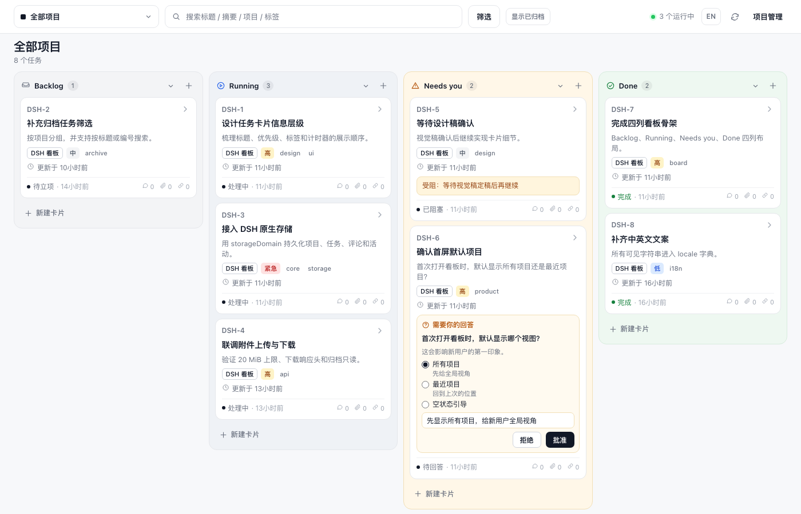
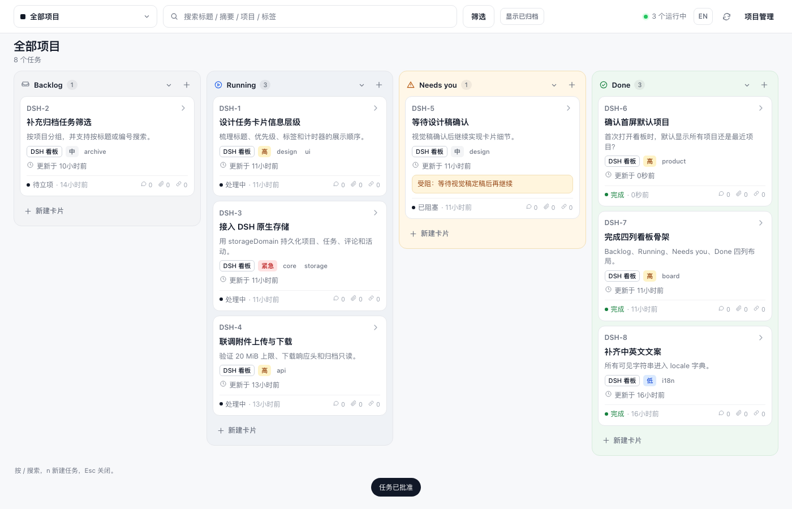

**Header hierarchy note:** the top-right status slot displays `3 个运行中` (a passive count) while the two tasks that need a human are not counted anywhere outside the lane header. On a "human-in-the-loop" board, the action count belongs in the header.

### 5.2 Open a card, scan attributes, find attachments and activity

Opening `?task=DSH-6` slides a 620px drawer over the board. The first screen is a full-width title input, status/priority, assignee, timestamps, description, tags, and the save/archive pair. It reads like a form, not an inspector: every field is 575px wide, inputs are 13px, and only two `h3` sections exist — `属性` (1,638px tall) and `移动` (125px). The attachment section starts at y=1,205 (305px below the fold), comments at 1,380, activity at 1,576, and Move at 1,765 — all inside the `属性` section.

The status is the most misleading element: it is rendered with a status dot exactly like the radio options in the question panel, but it is a `<span class="attr-static">` — clicking it does nothing. The only real status change lives 865px below the fold in `移动`, with only two of the four destinations.

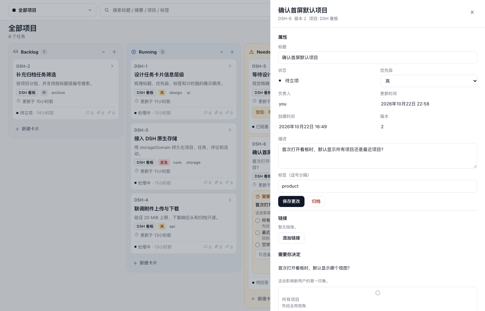
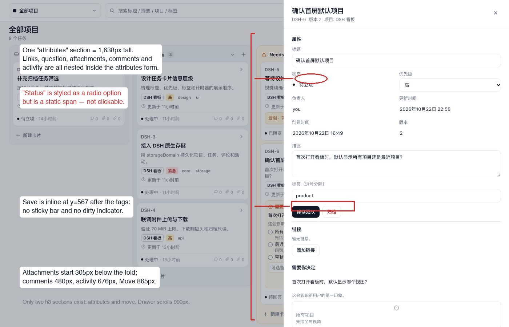

Attachments are 305px below the fold. When I get there, the "upload" control is a raw browser file input (`选择文件 / 未选择任何文件`) sitting under a separate `上传文件` label — a duplicated affordance and the single most visibly unfinished element in the product.

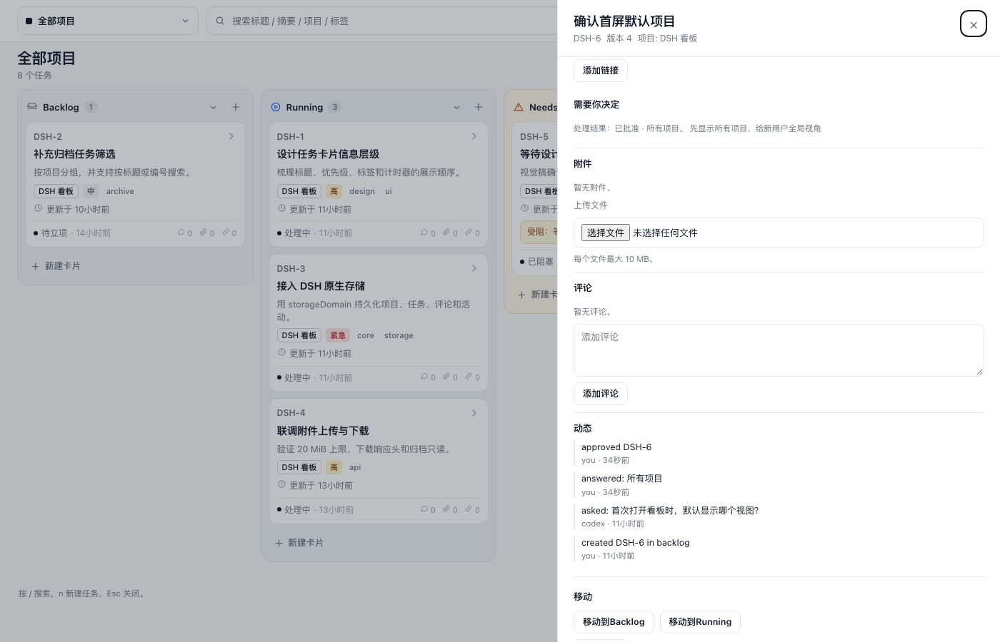
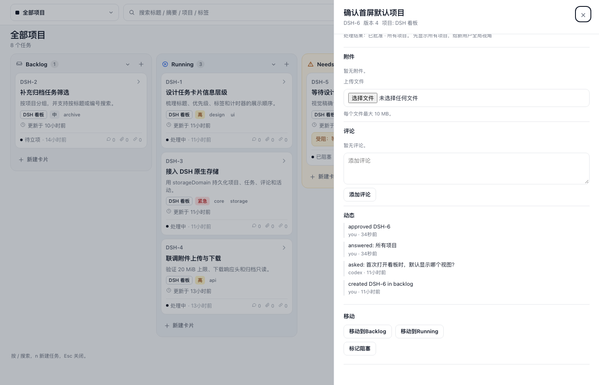

The activity feed is a developer log: `approved DSH-6`, `answered: 所有项目`, `asked: ...`, `created DSH-6 in backlog`, actors `you` / `codex`, with no localisation and no grouping. In the same view, the resolution is a single run-on line: `处理结果：已批准 · 所有项目。 先显示所有项目，给新用户全局视角`.

### 5.3 Projects: create, switch, archive, restore

The project manager is a 660×599 centred dialog with a create form and a list of projects. The form is clear and well labelled; prefix and workspace path are optional with a useful hint. But `新建项目` leaves the dialog open and the board still on `全部项目`; the new project only appears in the list, and the rows are not clickable. To actually use it I must close the dialog and reach for the top select.

Archive is good: the row's status chip flips to `已归档`, the action flips to `恢复`, and the top select appends `（已归档）`. Restoring is one click. The modal still calls itself `项目` while the button that opens it says `项目管理`, and there is a ~37px empty band under the header.

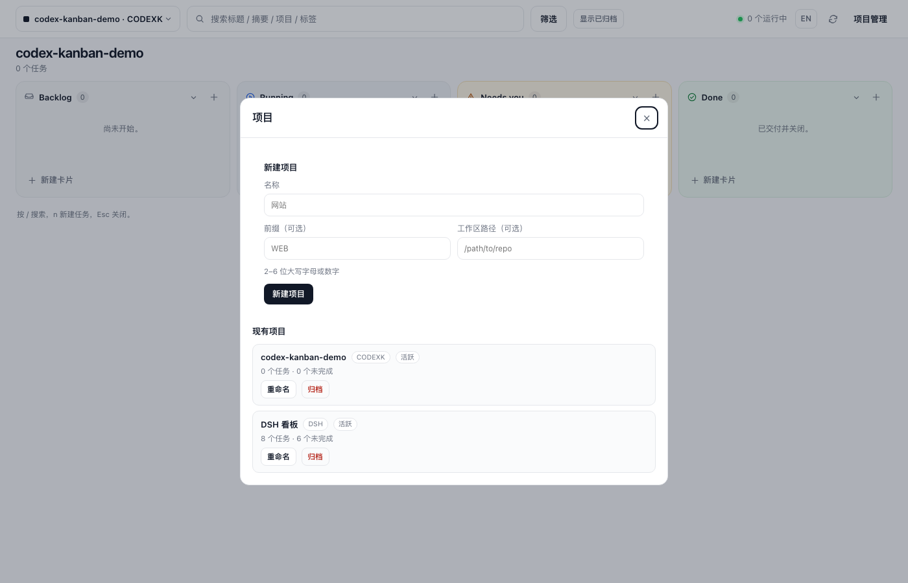
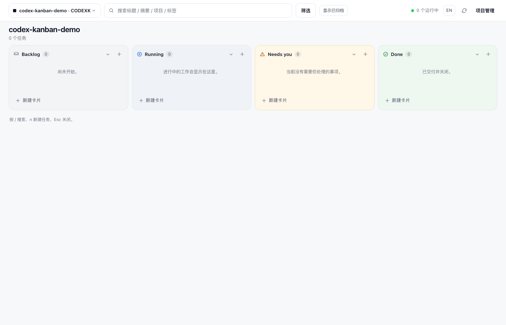

The empty-project state deserves credit: each lane has a different, human sentence (`尚未开始。`, `进行中的工作会显示在这里。`, `当前没有需要你处理的事项。`, `已交付并关闭。`), not one generic placeholder.

### 5.4 Filter, search, clear

Opening `筛选` gives a 300px popover with three native selects, a clear button and `显示 8 / 8`. Applying `高` gives four cards. I close the popover, and there is **no trace** that a filter is active: the button still says `筛选`, has no badge, and the board subtitle still says `8 个任务`. Only the hidden popover knows `显示 4 / 8`. Column empty states say `没有任务匹配当前筛选，清除筛选即可查看全部任务。` — but there is no clear button in that state, and each lane still offers `新建卡片`.

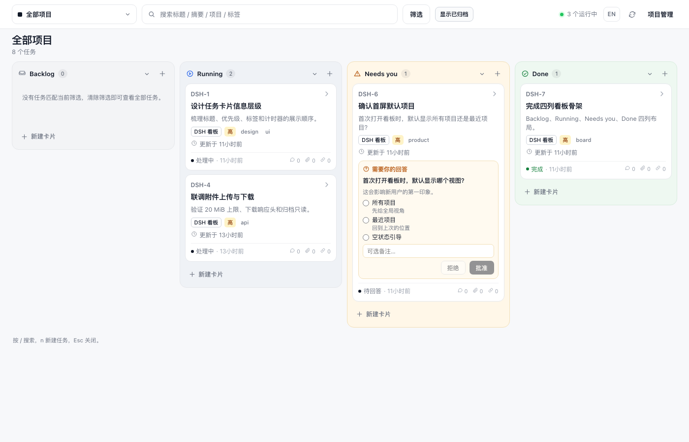
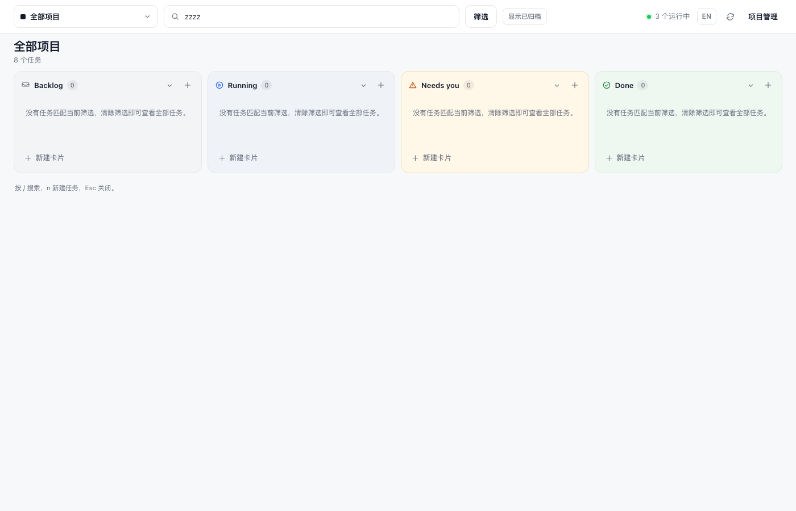

Search behaves better: typing `存储` leaves one card; `Esc` clears the query. But after `Esc` the input keeps focus, so the next `n` goes into the search box instead of opening the new-task dialog.

### 5.5 Collapse, archive, keyboard

Collapsing Done works and survives reload (`codex-kanban.collapsed = ["done"]`), and the button label changes to `展开Done`. The collapsed lane becomes a 48px tinted header but keeps its 330px grid column, leaving a large empty bay to the right of the board.

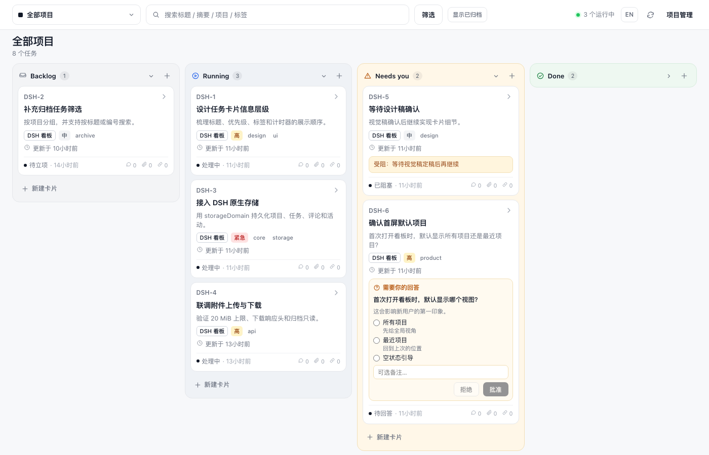

Archiving DSH-8 closes the drawer, removes the card, and shows `任务已归档`. Turning on `显示已归档` flips the label to `隐藏已归档`, restores the card with reduced opacity and a `已归档` chip; opening it shows an amber read-only banner and a `恢复` button. This flow is coherent and trustworthy.

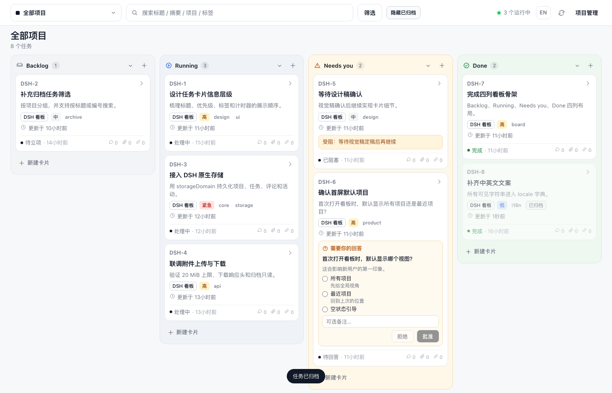

Keyboard: `/` focuses search with a clear 2px black ring; `n` from the body opens a 560×442 dialog focused on the title; `Esc` closes it and returns focus to the body. The advertised chain `"/" → Esc → "n"` fails because Esc does not blur the search.

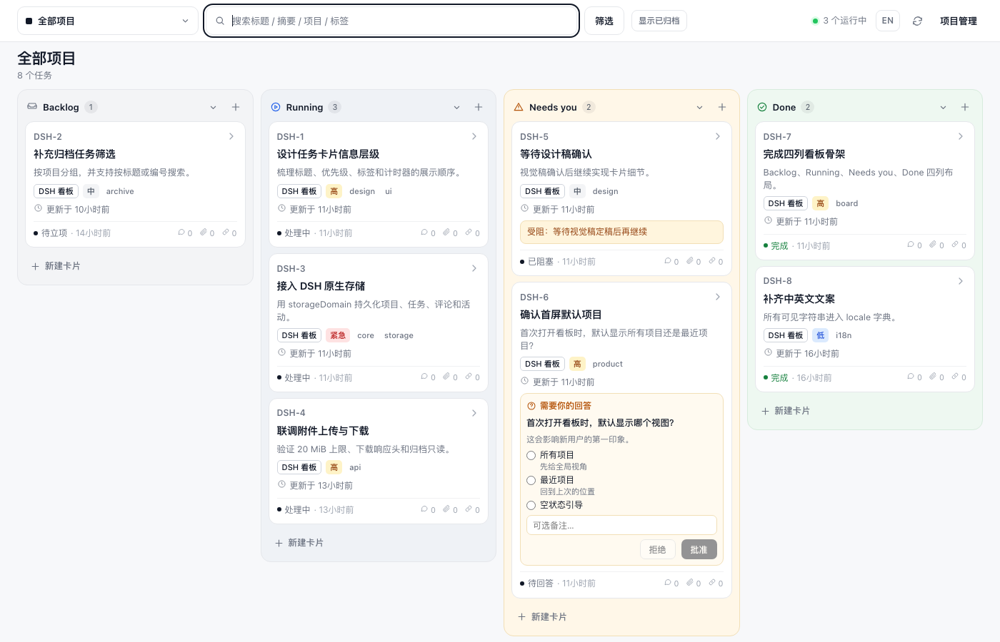
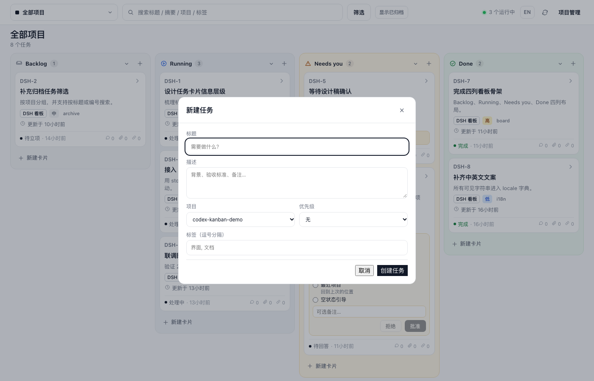

### 5.6 1024 and 390

At 1024 the four lanes still fit, but each card is 215px wide. The metric row takes 84px, leaving the status label a 26px box: `待立项` renders `待…`, `处理中` renders `处…`. `项目管理` wraps to two lines in a 32px button. The result is a board that looks broken on a very ordinary laptop width.

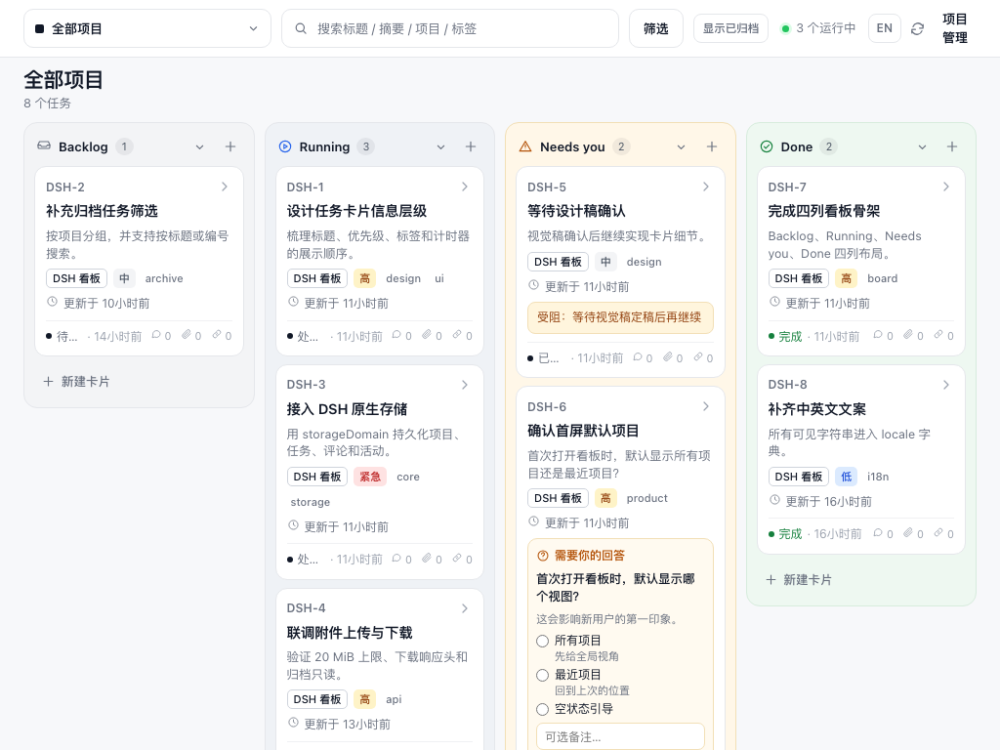

At 390 the columns stack correctly and the drawer becomes full-width (good). The toolbar does not: `document.documentElement.scrollWidth` is 854. Only the project select and half the search are visible; filter, archived, EN, refresh and projects are off-screen. Scrolling 460px right produces a blank page because the extra width is caused by the header, not the board.

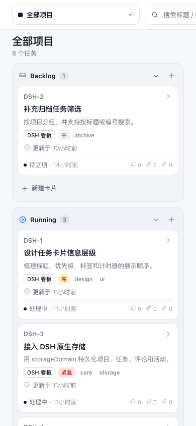
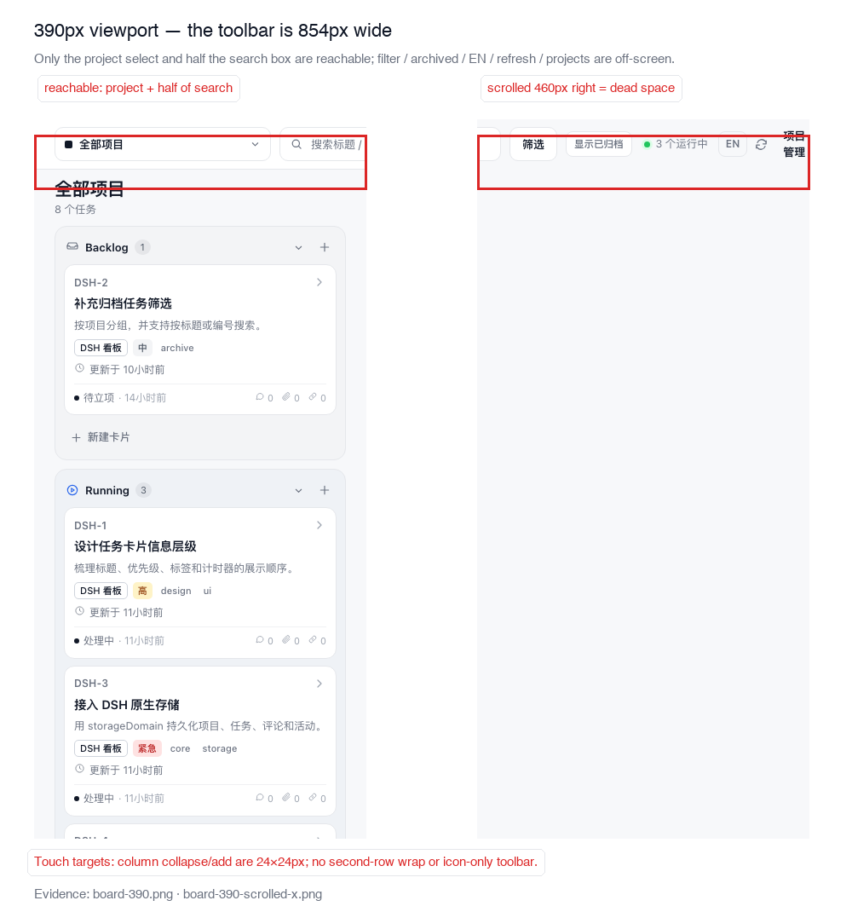

### 5.7 English mode

EN can be forced with `localStorage.setItem('codex-kanban.lang','en')` then reload (the same key the in-app toggle writes). It is a complete pass on UI chrome — `All projects`, `Filters`, `Show archived`, `New card`, `Needs your answer`, `Approve` — and the priority chips grow to `Medium`/`High`/`Urgent`. Board content stays Chinese because it is demo data, which is expected. The only mixed-language surprise is the *generated* drawer activity log, which stays English even in zh mode.

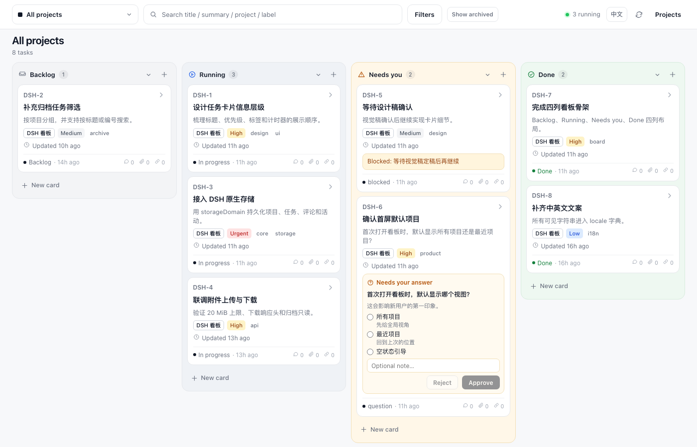

---

## 6. Findings

### F1 · [High] Responsive — The toolbar is 854px wide inside a 390px viewport, and 1024px clips every status

**Category** · Responsive

**I notice** · At 390px, the header shows only the project selector and part of the search field. The remaining five controls (筛选, 显示已归档, EN, refresh, 项目管理) sit off-screen; scrolling right reveals dead space, not the board. At 1024px, `.card-status-label` gets a 26px box for three glyphs, so `处理中` becomes `处…` and `待立项` becomes `待…`; `项目管理` wraps to two lines.

**I wonder** · Is this board intentionally desktop-only? If so, the phone view should say so rather than presenting a broken toolbar. If not, the first screen on a phone is missing most of the controls.

**What if** · The toolbar became two deliberate rows below 720px, and the card footer dropped zero counts below 1100px?

**Evidence** · `docs/ux-review/board-390.png` (`.topbar-inner`, measured `scrollWidth` 854), `docs/ux-review/board-390-scrolled-x.png`, `docs/ux-review/evidence-mobile-overflow.png`, `docs/ux-review/board-1024.png` (`.card-status-label` 26×17, `text-overflow: ellipsis`), `docs/ux-review/evidence-1024.png`.

**Fix** · At ≤720px set `.topbar-inner` to a two-row grid: row 1 = project chip + search (full width, `min-width:0`), row 2 = icon-only 44×44 buttons for filter/archive/lang/refresh/projects; at ≤1120px hide metrics whose value is 0 and let `.card-footer` wrap. Because five of seven toolbar controls are currently unreachable on a phone, and every card's primary state label is truncated on a 1024px laptop.

---

### F2 · [High] Typography — The identifier owns a line, the title is 14.5px, and the column header is smaller than the cards it labels

**Category** · Typography

**I notice** · Each card starts with `DSH-2` on its own 12px line, then a 14.5px/600 title on the next line. The column titles are 13px/600. The reference puts `DSH-1 设计任务卡片信息层级` on one line at roughly 18px, so the identifier and title share a single, strong scan line.

**I wonder** · Is the identifier more important than the title? Right now it consumes a full line and pushes the title down while the title itself is only 0.5px larger than body text.

**What if** · The identifier became a quiet prefix on the same line as a 17px title, and the column header grew to 15px?

**Evidence** · `docs/ux-review/board-1400.png` (`.card-identifier` 12px/600, `.card-title` 14.5px/600, `.column-title` 13px/600), `docs/ux-review/evidence-card-scale.png` (reference vs app at equal card width).

**Fix** · Render `DSH-6` inline before the title at 13px/600 in `--muted`, set `.card-title` to 17px/600 with 1.3 line-height, and `.column-title` to 15px/650. Because the title is currently barely above body size, and the lane header is quieter than the content it introduces.

---

### F3 · [High] Spacing & layout — Cards are packed at half the reference's breathing room, and three zero counters eat the footer

**Category** · Spacing & Layout

**I notice** · Card padding is 11px, card-to-card gap 8px, lane gap 10px, chips 11px/20px. The reference reads at roughly 18px card padding and 16px card gaps with 14px chips. Every card also spends 84px on `0 0 0` metrics, and the topbar mixes 40px (search/filter), 30px (archive toggle) and 32px (EN/refresh/projects) control heights.

**I wonder** · Was the board tuned to fit four lanes at 1024px at the cost of the scan? The reference feels larger at a comparable card width, because the type and the space do the work.

**What if** · Card padding went to 14px, the card gap to 12px, and zero metrics disappeared entirely?

**Evidence** · `docs/ux-review/evidence-card-scale.png`, `docs/ux-review/board-1400.png` (`.card` padding 11px, `.card-metrics` 84×16), `docs/ux-review/board-1024.png` (status clipped by the metric row).

**Fix** · Set `.card{padding:14px}`, `.board{gap:14px}`, `.card + .card{margin-top:12px}`, chips to 12px/22px, and render only non-zero metrics. Align topbar control heights to 40px (or all 32px icon-only). Because the air is the reference's premium signal, and the zeros are the direct mechanical cause of the 1024px truncation.

---

### F4 · [High] Visual hierarchy — The drawer is one 1,638px "attributes" block doing seven jobs

**Category** · Visual Hierarchy

**I notice** · The drawer has only two `h3` sections: `属性` (1,638px) and `移动` (125px). Links, the question, attachments, comments and activity are all nested inside `属性`. Attachments start 305px below the fold, activity 676px, Move 865px. Save is an inline button at y=567 after the tags, not a persistent action. The reference's drawer is a grouped inspector: attribute rows, tags, description, blocker, links and request each have their own labelled band and divider.

**I wonder** · Why is an attachment an attribute? The label `属性` promises metadata, then delivers a 990px scroll of collaboration and history.

**What if** · The drawer had three jobs — Details, Collaboration, History — with a sticky save bar?

**Evidence** · `docs/ux-review/drawer-1400.png`, `docs/ux-review/evidence-drawer-ia.png` (`section.panel` 1,638px; attachment section y=1,205 (`#attachment-input` y=1,303); activity y=1,576; `#move-actions` y=1,765), `docs/ux-review/evidence-drawer-compare.png`.

**Fix** · Split into tabs or clearly divided sections: **详情** (title, status, priority, assignee, dates, description, tags), **协作** (links, question, attachments, comments), **动态**, and keep **移动/阻塞** as secondary actions. Put `保存更改` in a sticky drawer footer with a dirty indicator. Because a drawer is a scanning surface; if finding an attachment requires 305px of scroll, the grouping is decoration rather than structure.

---

### F5 · [High] Interaction states — A filter can hide half the board without leaving a trace, and the no-results state repeats itself four times

**Category** · Interaction States

**I notice** · After applying `高` and closing the popover, four cards remain. The 筛选 button has no badge, active class or count; `.board-meta` still says `8 个任务`; the only indication that a filter is active is the reduced column counts, and the only result count is inside the hidden popover (`显示 4 / 8`). Searching `zzzz` renders `没有任务匹配当前筛选，清除筛选即可查看全部任务。` four times, once per lane, each with its own `新建卡片`, and no clear-filters control in that state. The copy tells me to clear filters but does not give me a way to do it.

**I wonder** · Would a reasonable user conclude that four tasks were deleted? The board looks like a complete board, not a filtered view.

**What if** · Active filters appeared as removable chips beside 筛选, the board subtitle read `4 / 8 个任务`, and the no-results state were one board-level message with a `清除筛选` button?

**Evidence** · `docs/ux-review/filter-active-closed-1400.png` (4 cards, `8 个任务`, unchanged `.filter-toggle`), `docs/ux-review/search-empty-1400.png` (four identical `.column-empty` blocks), `docs/ux-review/filter-open-1400.png` (`#filter-count`: `显示 4 / 8`).

**Fix** · Add a filter summary row under the toolbar (`高 ×`, `design ×`) and change `.board-meta` to `4 / 8 个任务` whenever a filter or search is active. Replace the per-column no-match copy with one board-level empty state containing `清除筛选`, and hide `新建卡片` while filtering. Because invisible filter state is indistinguishable from lost data, and four copies of the same sentence is noise, not guidance.

---

### F6 · [Medium] Interaction states — Two decision controls lie: status looks like a radio, and the drawer's question radios float 280px from their labels

**Category** · Interaction States

**I notice** · In the drawer, `状态` is `<span class="attr-static attr-status">` with a status dot and `cursor:auto` — visually identical to a filled radio option, but not clickable. The only way to change status is the `移动` section 865px below, with two destinations. In the drawer's question section, each option is a 575×73 grid whose radio input is 553×13; the native circle is centered at x≈1090 while the label starts at x=814. The inline panel gets this right (radio at left, 28px rows).

**I wonder** · Which of these two controls am I supposed to click to answer the question? The drawer also shows `记录答案`, `批准` and `拒绝` together with the hint "先记录答案，再批准或拒绝", so the required sequence is explained but not embodied.

**What if** · Status were a real segmented control or select next to 优先级, and the drawer reused the inline panel's option row?

**Evidence** · `docs/ux-review/drawer-1400.png` (`#attr-status` markup/cursor), `docs/ux-review/drawer-question-1400.png` (radio input 553×13 at x=814; circle near x=1090), `docs/ux-review/question-filled-1400.png` (correct inline treatment).

**Fix** · Replace the static status with a 4-way select or segmented control at the top of the drawer, and keep `移动` as a secondary menu. Style drawer options as `grid-template-columns:16px 1fr; align-items:start`, with `input[type=radio]{width:16px;height:16px;margin-top:2px}`. Because the most important state change and the most important decision are currently represented by a lie and a misaligned control.

---

### F7 · [Medium] Consistency — Native browser chrome leaks into a designed surface

**Category** · Consistency / AI slop

**I notice** · The filter popover and the drawer's priority field use unstyled native `<select>` elements with the OS chevron. The attachment upload is a raw `<input type="file">` (575×42) under a separate `上传文件` label. Archiving calls `window.confirm()` — I verified the native dialog text `归档 DSH-8？恢复前它将从看板隐藏。` — so a grey browser dialog interrupts a product that otherwise has a consistent border-and-tint language.

**I wonder** · Would I trust the upload after seeing a browser-default file picker in the middle of a polished inspector? Would the confirm feel like the same product?

**What if** · The select, the file drop and the destructive confirmation were all first-class components?

**Evidence** · `docs/ux-review/drawer-attachments-1400.png` (`input[type=file]`), `docs/ux-review/filter-open-1400.png` (native selects), `docs/ux-review/projects-dialog-1400.png` (归档 action; I verified the native confirm text by overriding `window.confirm` and reading its argument).

**Fix** · Build a 40px select trigger with the same chevron and border as the project chip, a dashed dropzone with an explicit `选择文件` button plus drag-over state, and an in-product confirm sheet with the task name and destructive styling. Because these are the only moments the interface stops looking like one product — and the ones users remember when uploading or archiving.

---

### F8 · [Medium] Content quality — The activity feed reads like an English server log, and the timestamps contradict each other

**Category** · Content Quality

**I notice** · In a Chinese UI the activity entries are `approved DSH-6`, `answered: 所有项目`, `asked: ...`, `created DSH-6 in backlog`, with actors `you` and `codex`. After approval the card reads `更新于 0秒前` and `完成 · 0秒前`; DSH-2 reads `更新于 10小时前` on one line and `待立项 · 14小时前` on the next, with no label explaining that the second is dwell time.

**I wonder** · Is `14小时前` when the task entered 待立项, or a duplicate of updated? A user should not have to infer a data model from two numbers.

**What if** · Events were localised sentences, sub-minute ages read `刚刚`, and the second timestamp said `已停留 14小时`?

**Evidence** · `docs/ux-review/drawer-activity-1400.png`, `docs/ux-review/question-approved-1400.png` (`更新于 0秒前`), `docs/ux-review/board-1400.png` (DSH-2: 10小时前 vs 14小时前).

**Fix** · Localise generated events (`批准了 DSH-6 · 你`, `回答了「所有项目」`), use `你`/`Codex` for actors, group the feed by day with icons, show `刚刚` under 60 seconds, and label the dwell value (`已停留 14小时`) or remove it. Because the feed exists to answer "what happened, and when" — not to expose event codes.

---

### F9 · [Medium] Color & contrast — The smallest, most repeated metadata is also the lowest contrast

**Category** · Color & Contrast

**I notice** · `.card-metrics .metric` (11px) and `.card-dwell` (12px) are `#9ca3af` on white: **2.54:1**. The empty-state copy is `#6b7280` at 12px on the tinted lanes: **4.4:1**, just under the 4.5 threshold. The tag chips are 11px at 4.8:1 — technically passing, but too small to carry meaning.

**I wonder** · If the zero counts and dwell time are optional, why show them at all at a contrast that makes them disappear? If they matter, why make them the faintest text on the page?

**What if** · Non-zero metrics were 12px at 4.8:1, the dwell time were labelled and readable, and the empty-state copy used the 7:1 grey?

**Evidence** · `docs/ux-review/board-1400.png` (`.card-metrics` 11px `#9ca3af`, `.card-dwell` 12px `#9ca3af`, `.column-empty` on `#f3f4f6`), measurements from computed styles.

**Fix** · Raise metric and dwell text to `#6b7280` at 12px (4.83:1), keep icons at 12px, drop zero counts, and darken empty-state copy to `#4b5563` (≈7:1). Because the data that helps prioritise is the data that disappears first.

---

### F10 · [Medium] Interaction states — Esc clears the search but leaves focus there, so the next advertised shortcut types `n` into the field

**Category** · Interaction States

**I notice** · After `/` focuses search and `Esc` clears it, `document.activeElement` is still `#search`. Pressing `n` sets the query to `n` and the new-task dialog stays closed. From the body, `n` opens the dialog and focuses the title. The footer says `按 / 搜索，n 新建任务，Esc 关闭。`

**I wonder** · What did "Esc 关闭" mean? It closes dialogs but not the search context, so the advertised chain `/ → Esc → n` fails.

**What if** · Esc cleared a non-empty search and blurred an empty one, restoring the board-level shortcuts?

**Evidence** · `docs/ux-review/kbd-slash-1400.png`; measured: after Esc, `activeElement.id === "search"`, `search.value === "n"`, `#new-task-dialog.open === false`.

**Fix** · In the Escape handler: if the search is focused and has a value, clear it; if it is focused and empty, blur it; otherwise close the topmost layer. Keep the `n` handler as is. Because the footer's own three-key sequence is broken, and the failure quietly filters the board instead of opening the dialog.

---

## 7. Reference comparison

The reference is a 2658×2000 capture of the same product; to compare fairly I equalised card width. The palette, lane tints, card radius and border language are already very close. The differences are scale, grouping and native leakage.

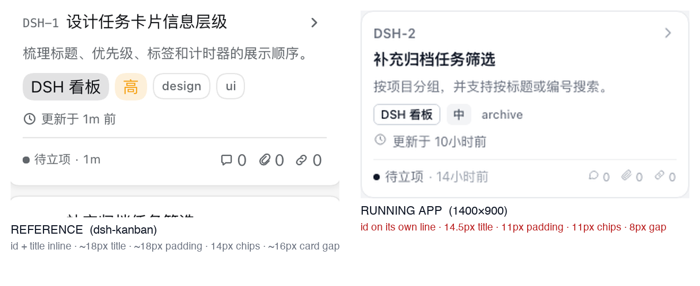
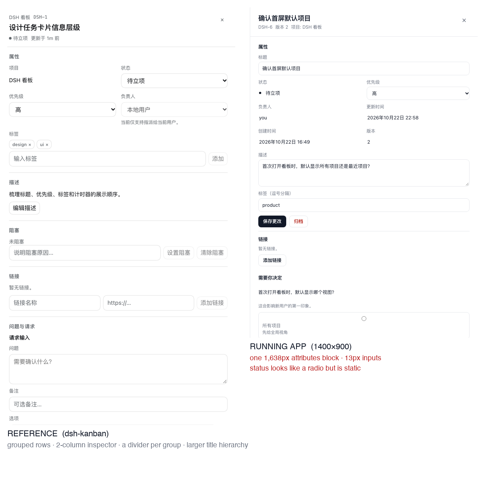

| Dimension | Reference (`dsh-kanban`) | Running app | Delta |
| --- | --- | --- | --- |
| Card title | ID + title on one line, ≈18px/600 | ID on its own 12px line; title 14.5px/600 | Title reads as body copy; one extra line per card |
| Body / description | ≈14px, airy | 12.5px | ~11% smaller |
| Chips | ≈14px, 24px tall; tags are bordered white pills | 11px, 20px tall; tags are borderless grey text | Chips stop being scannable; tags disappear |
| Card padding | ≈18px | 11px (12px incl. border) | ~35% tighter |
| Card gap / lane gap | ≈16px / ≈18px | 8px / 10px | ~50% tighter |
| Column header | Clearly above card content | 13px, smaller than the 14.5px card title | Hierarchy inverted |
| Topbar | Project, search, filter, running, refresh | Adds archived toggle, EN, projects; 40/30/32px heights | Busier and ragged; wraps at 1024 |
| Drawer | Grouped 2-column inspector, dividers per section | One 1,638px attributes block, 13px inputs, inline save | Becomes a form dump |
| Empty states | Not captured in the reference | Empty project is excellent; filtered empty repeats 4× | One strong state, one weak state |
| Motion | Not captured | 140ms drawer/backdrop only; no card-move transition | Functional but not explanatory |

Concrete deltas worth landing first: **type scale** (title 17–18, desc 14, chips 12–13), **card air** (padding 14–16, gap 12–16), **chip style** (tags get a 1px border and real padding), **inline ID + title**, **lane header above card title**, and **drawer grouping**.

---

## 8. Quick wins (under ~30 minutes each)

| # | Fix | Effort | Why it pays |
| --- | --- | --- | --- |
| 1 | Card type/spacing refresh: ID inline, title 17px, desc 13.5px, padding 14px, gap 12px, chips 12px | ~20 min | Instantly moves the board from "compressed admin table" toward the reference; no structural change |
| 2 | Hide zero metrics and let `.card-footer` wrap | ~10 min | Fixes the 1024px "处…" truncation and gives the title room; removes noise |
| 3 | Two-row toolbar below 720px, 44px icon targets, project chip `min-width:0` | ~20 min | Removes the 854px phone overflow and makes five controls reachable |
| 4 | Esc clears + blurs search; drawer option grid `16px 1fr`, radio 16×16 | ~10 min | Restores the advertised `/ → Esc → n` chain and fixes the floating radio |
| 5 | Active filter chips + `4 / 8 个任务` + one board-level no-results state with `清除筛选` | ~20 min | Prevents "where did my tasks go?" and removes four repeated messages |

---

## 9. What already works

- **The inline question panel is the product.** Options with details, an optional note, a clear primary `批准`, and a disabled state until a choice is made. It is the best interaction in the app.
- **The color system is disciplined.** Warm amber for needs, cool green for done, no gradients, no decorative shadows. The reference's identity survives.
- **The archive loop is trustworthy.** Label flip, dimmed card, `已归档` chip, amber read-only banner, one-click restore.
- **Empty project copy is human.** Four different sentences, one job each.
- **Focus rings are strong** (2px dark) and dialogs are responsive at 390px.
- **Performance is excellent.** 12.6ms DCL, 17ms load, immediate interactions, no layout jank.

---

## 10. Methodology and limits

- Chrome headless (`--headless=new`), CDP-driven, device scale factor 1 for the required screenshots. Viewports: 1400×900, 1024×768, 390×844.
- Measured computed styles and geometry via the DOM; did not read implementation source or modify app code/tests.
- EN mode was forced with `localStorage['codex-kanban.lang']='en'` + reload — the same key the in-app toggle writes; `en-1400.png` is the result.
- The demo board was mutated to walk the flows (DSH-6 answered/approved, DSH-8 archived/restored, a temporary project created/archived). Its `.kanban/board.json` was backed up before and **restored byte-for-byte afterward**; the final API check shows the original 8 tasks, 2 active projects, DSH-6 pending, 0 archived tasks.
- The 390px full-page capture is 854px wide *because of the overflow it documents*.
- Native control appearance is Chrome/macOS-specific; Firefox/Safari were not tested.
- No commit was made. Only this report and the screenshots under `docs/ux-review/` were written.

---

## 11. Screenshot index

All paths are relative to `docs/ux-review/`.

| File | Size | Shows |
| --- | --- | --- |
| `board-1400.png` | 1400×900 | Required: default zh board |
| `board-1024.png` | 1024×768 | Required: 1024 laptop, status clipping |
| `board-390.png` | 390×844 | Required: phone, clipped toolbar |
| `drawer-1400.png` | 1400×900 | Required: drawer for DSH-6 |
| `zh-1400.png` | 1400×900 | Required: zh default (duplicate state) |
| `en-1400.png` | 1400×900 | Forced EN via localStorage |
| `board-1400-full.png` | 1400×974 | Full desktop page |
| `board-390-full.png` | 854×2368 | Full mobile page incl. dead horizontal space |
| `board-390-scrolled-x.png` | 390×844 | Scrolled 460px right: blank |
| `evidence-mobile-overflow.png` | 1000×1070 | Annotated mobile overflow |
| `evidence-1024.png` | 1000×470 | Annotated 1024 clipping / wrap |
| `evidence-card-scale.png` | 1320×541 | Reference card vs app card, labeled |
| `evidence-drawer-compare.png` | 1320×1307 | Reference drawer vs app drawer, labeled |
| `evidence-drawer-ia.png` | 1400×900 | Annotated drawer anatomy |
| `question-filled-1400.png` | 1400×900 | Inline question with selection + note |
| `question-approved-1400.png` | 1400×900 | Post-approval, toast, `0秒前` |
| `drawer-question-1400.png` | 1400×900 | Drawer options with radio at right |
| `drawer-attachments-1400.png` | 1400×900 | Attachment/comment/activity band, native file input |
| `drawer-activity-1400.png` | 1400×900 | Activity feed, Move/Block |
| `filter-open-1400.png` | 1400×900 | Filter popover, native selects |
| `filter-high-1400.png` | 1400×900 | Filtered to 高 |
| `filter-active-closed-1400.png` | 1400×900 | Filter active with no visible state |
| `search-1400.png` | 1400×900 | Search `存储`, 1 result |
| `search-empty-1400.png` | 1400×900 | No-results state ×4 |
| `collapse-1400.png` | 1400×900 | Collapsed Done lane |
| `collapse-persist-1400.png` | 1400×900 | Same after reload |
| `archive-toggle-1400.png` | 1400×900 | 隐藏已归档, dimmed archived card |
| `archived-task-drawer-1400.png` | 1400×900 | Read-only banner + 恢复 |
| `projects-dialog-1400.png` | 1400×900 | Project manager |
| `project-created-1400.png` | 1400×900 | New project created via UI |
| `project-archived-1400.png` | 1400×900 | Archived project row and 恢复 |
| `empty-project-1400.png` | 1400×900 | Empty project, per-lane copy |
| `new-task-dialog-1400.png` | 1400×900 | New task dialog |
| `new-task-dialog-390.png` | 390×844 | New task dialog on phone |
| `projects-dialog-390.png` | 390×844 | Project manager on phone |
| `kbd-slash-1400.png` | 1400×900 | Search focus ring from `/` |
| `drawer-1024.png` | 1024×768 | Drawer at 1024 |
| `drawer-390.png` | 390×844 | Drawer at 390 (usable, full width) |

---

**One-line verdict** · The board's bones are good and its inline approvals are excellent, but it runs at 85% of the reference's scale, the drawer is a 1,638px form, and at 390px the toolbar simply does not exist — fix scale, grouping and the mobile header before adding anything new.
