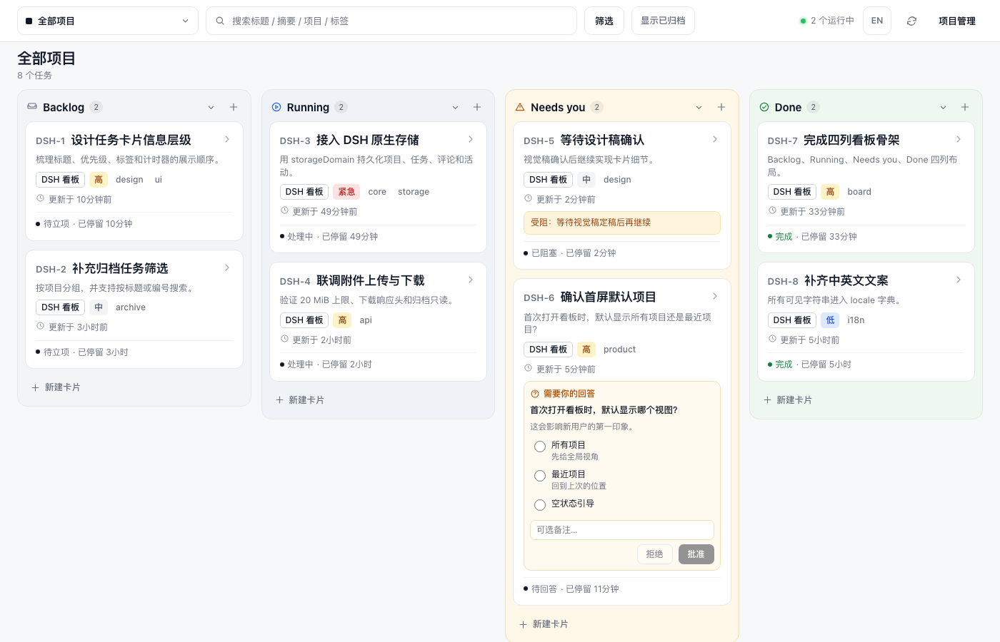

# Codex Kanban — UX & Design Audit, Round 2

**Target** · http://127.0.0.1:4399 (demo board: 8 tasks, 2 projects, zh default)
**Date** · 2026-10-23
**Reviewer stance** · Senior product designer; rendered UI and computed DOM, not implementation review.
**Baseline** · [`ux-audit-2026-10-23.md`](ux-audit-2026-10-23.md) — Design **C** 2.80, AI Slop **B**, goodwill **43/100**, findings F1–F10.
**Reference** · `dsh-kanban/docs/assets/kanban-board.png`, `kanban-drawer.png`

**Headline scores**

| | Baseline | Round 2 | Delta |
| --- | --- | --- | --- |
| **Design Score** | **C** (2.80 / 4.0) | **B** (3.42 / 4.0) | **+0.62** |
| **AI Slop Score** | **B** | **B** | **0** |
| **Goodwill** | **43 / 100** | **90 / 100** | **+47** |
| **F1–F10** | 0 fixed | **9 FIXED · 1 PARTIAL · 0 NOT FIXED** | — |

> **Verdict** — Round 2 is real remediation, not a coat of paint: the board now reads at reference scale, the phone path works, dialogs and activity feel like one product, and nine of ten findings are fully closed. The biggest remaining gap is the drawer's new tab model: the default 详情 tab hides the pending decision, so a human-in-the-loop board still makes you hunt for the thing that needs you.

---

## 0. What changed at a glance

| Area | Baseline | Round 2 |
| --- | --- | --- |
| Board scale | 14.5px title, ID on its own line, 11px padding, 8/10px gaps | 17px title with inline 13px ID, 14px card padding, 12/14px gaps; column header 15px |
| Card footer | `0 0 0` metrics eating 84px, status clipped at 1024 | Zero metrics removed; status and labelled dwell (`待立项 · 已停留 10分钟`) on one line |
| 390px | 854px toolbar inside a 390px viewport; five controls off-screen | Two-row toolbar (112px), 44×44 targets, `scrollWidth === innerWidth === 390` |
| 1024px | `处理中` clipped to `处…`; 项目管理 wrapped | No clipping; status 36×17 fully visible; 项目管理 72×40 on one line |
| Drawer | One 1,638px 属性 block, inline save at y=567 | Three tabs, grouped bands, sticky 57px footer at y=843, disabled save until dirty |
| Status / question | Fake radio status; radios 280px from labels | Real 6-option status select; 16×16 radio at x=812, label at x=832 |
| Filter | Active filter invisible; four repeated empty messages | Badge `1`, active outline, `高 ×` chip, `4 / 8 个任务`, one board-level empty with 清除筛选 |
| Dialogs | Native `confirm()`; native file input; native selects | Custom decision sheet (560×276), archive sheet (420×172), dropzone, custom select menus |
| Activity | `approved DSH-6`, `you`, `codex` | `Codex提问：…`, `你创建了 DSH-6（待立项）`, grouped by 今天, 刚刚/分钟前 |
| Keyboard | `/ → Esc → n` typed `n` into search | Esc clears and blurs; `n` opens the dialog and focuses the title |

The first impression at 1400×900 is now close to the reference: four pale lanes, a warm amber *Needs you* lane, an inline question that opens without a modal, and card titles that actually lead. The board no longer reads as a compressed admin table.



---

## 1. Scorecard

Grades are holistic against the same rubric as round 1 (A = 4.0, A− = 3.7, B+ = 3.5, B = 3.0, C = 2.0, D = 1.0, F = 0). I did not apply a mechanical one-letter drop per finding, because two of the new issues are trade-offs created by an otherwise correct restructuring.

| Category | Weight | Baseline | Round 2 | Numeric | Δ | Why |
| --- | --- | --- | --- | --- | --- | --- |
| Visual hierarchy | 15% | B | **B+** | 3.5 | +0.5 | The amber lane and inline question are stronger anchors at the new scale. The drawer header, however, carries no status and the default tab hides the decision (R1). |
| Typography | 15% | B | **B+** | 3.5 | +0.5 | Title 17/600, inline ID 13/600, column header 15/650; body 14, chips 12. The scale now matches the reference within 1px. Tags remain loose grey text, and the family is still system-ui. |
| Spacing & layout | 15% | B | **B+** | 3.5 | +0.5 | 14px card padding, 12px card gap, 14px lane gap, 22px chips — roughly the reference's air. The filter summary bar (1,352×45 for one chip) and the 270px drawer void keep it from an A. |
| Color & contrast | 10% | B | **A−** | 3.7 | +0.7 | Every measured text pair now passes AA: dwell/tag/ID 4.83:1, empty copy 6.87:1, board meta 4.55:1. The 2.54:1 metadata is gone. |
| Interaction states | 10% | C | **B** | 3.0 | +1.0 | Filter state, keyboard chain, radios, status select and custom confirmations are all fixed. The decision dialog still inverts emphasis and drops the answer (R2); mobile icons are unlabelled (R4). |
| Responsive | 10% | C | **A−** | 3.7 | +1.7 | 390px and 1024px are now deliberate layouts with no clipping or overflow; the drawer is full-width at 390 with a 53px sticky footer at y=791. The phone toolbar is semantically ambiguous, not broken. |
| Content quality | 10% | B | **B+** | 3.5 | +0.5 | Activity is localised and clock-corrected; dwell is labelled; filtered-empty is one message. The empty state does not echo the query, and the header still counts the wrong thing (R3). |
| AI Slop | 5% | B | **B** | 3.0 | 0 | No purple, gradients, emoji, 3-column grid or decorative cards. Still system-ui and uniform 10–12px radii; it reads as a well-built local tool, not a branded product. |
| Motion | 5% | C | **C** | 2.0 | 0 | Drawer/backdrop/toast 120–170ms; tab switches, filter changes and card moves are instant. Motion still explains nothing. |
| Performance feel | 5% | A | **A** | 4.0 | 0 | DCL 14.2ms, load 43.7ms, 713 DOM nodes, 210KB document; every interaction is immediate. Transfer grew from 138KB but is still negligible on localhost. |

**Weighted Design Score: 3.42 / 4.00 = B.** (0.15×3.5 + 0.15×3.5 + 0.15×3.5 + 0.10×3.7 + 0.10×3.0 + 0.10×3.7 + 0.10×3.5 + 0.05×3.0 + 0.05×2.0 + 0.05×4.0 = 3.415.)

Desktop alone would be an A−; the drawer attention model and motion bring it to a solid B.

**AI Slop Score: B.** It does not look template-generated and it has a point of view: warm amber for human attention, cool green for done, pale tinted lanes, line icons, no shadows. What keeps it from an A is the browser-system typeface and the places where tags and header metadata fall back to plain grey text.

---

## 2. F1–F10 re-check

| ID | Baseline finding (short) | Status | Evidence | Key measurement |
| --- | --- | --- | --- | --- |
| **F1** | 390px toolbar 854px wide; 1024px clips every status | **FIXED** | [`round2-board-390.png`](round2-board-390.png), [`round2-board-1024.png`](round2-board-1024.png) | 390: `innerWidth = scrollWidth = 390`; topbar 390×112 in two rows; 5 controls at 44×44, y=60, none off-screen. 1024: topbar 1024, no scroll; status 36×17 full; 项目管理 72×40 on one line. |
| **F2** | ID owns a line, title 14.5px, column header 13px | **FIXED** | [`round2-board-1400.png`](round2-board-1400.png) | `.card-title` 17px/600; `.card-identifier` 13px/600 at x=50, inline before title at x=99; `.column-title` 15px/650. |
| **F3** | 11px padding, 8px gaps, chips 11px, zero counters | **FIXED** | [`round2-board-1400.png`](round2-board-1400.png) | `.card` padding 14px; card gap 12px; lane gap 14px; chips 12px/22px; no `.card-metrics` element remains; topbar controls all 40px. |
| **F4** | Drawer is one 1,638px 属性 block doing seven jobs | **FIXED** | [`round2-drawer-detail.png`](round2-drawer-detail.png), [`round2-drawer-collab.png`](round2-drawer-collab.png), [`round2-drawer-activity.png`](round2-drawer-activity.png) | Drawer 620px; 3 tabs at 50×40; 详情 band 473px; 协作 1,007px; 动态 722px; footer `position: sticky`, `bottom: 0`, top 843; groups 链接 / 需要你决定 / 附件 / 评论 / 操作. |
| **F5** | Active filter leaves no trace; empty copy repeats 4× | **PARTIAL** | [`round2-filter-active.png`](round2-filter-active.png), [`round2-empty.png`](round2-empty.png) | Fixed: meta `4 / 8 个任务`, badge 1 at 17×17, `.active` outline, chip `高 ×`, one board-level empty `0 / 8` with 清除筛选, columns/create hidden in empty. Remaining: **4 新建卡片 controls still render while a filter is active**, so a new card can be created straight into a filtered-out state. |
| **F6** | Static status looks like a radio; drawer radios float 280px from labels | **FIXED** | [`round2-drawer-detail.png`](round2-drawer-detail.png), [`round2-drawer-collab.png`](round2-drawer-collab.png) | Status is a real select-trigger, 281×40, 6 options (待立项/等待认领/处理中/等你确认/完成/已取消). Question radio is 16×16 at x=812 with label at x=832 inside a 575px row. |
| **F7** | Native select/file/confirm chrome leaks | **FIXED** | [`round2-ask-dialog.png`](round2-ask-dialog.png), [`round2-confirm.png`](round2-confirm.png), [`round2-evidence-archive-confirm.png`](round2-evidence-archive-confirm.png), [`round2-evidence-filter-popover.png`](round2-evidence-filter-popover.png) | Filter selects are 274×40 triggers with 274×174 menus; file input is 0×0 behind a 575×58 dashed dropzone with 选择文件; task archive opens a 420×172 sheet; decision opens a 560×276 sheet; `window.confirm` calls: 0; no browser-default dialog (all overlays are product-styled). |
| **F8** | English server log; contradictory timestamps | **FIXED** | [`round2-drawer-activity.png`](round2-drawer-activity.png) | Activity is grouped by `今天` and localised: `Codex提问：首次打开看板时，默认显示哪个视图？ 2分钟前`, `你创建了 DSH-6（待立项）14分钟前`. Card dwell is labelled `已停留 10分钟`; no `approved`/`created` event codes. |
| **F9** | 2.54:1 metadata; 4.4:1 empty copy | **FIXED** | [`round2-board-1400.png`](round2-board-1400.png) | `.card-dwell`, `.chip.tag`, `.card-identifier` = 12–13px `#6b7280` on white, **4.83:1**; `.column-empty` 12px `#4b5563` on `#f3f4f6`, **6.87:1**; meta 4.55:1. All pass AA. |
| **F10** | Esc leaves focus in search, so `n` types into it | **FIXED** | [`round2-board-1400.png`](round2-board-1400.png) | `/` → active `#search`; Esc → value empty, `document.activeElement` body; `n` → `#new-task-dialog.open === true`, focus `#new-task-title`. Footer now reads `Esc 清除或关闭`. |

**Result: 9 FIXED, 1 PARTIAL, 0 NOT FIXED.**

F5 is the only partial, and it is a small one: the invisible-filter problem — the dangerous half of the finding — is solved. The missing sub-item is the baseline's request to hide 新建卡片 while filtering; with a priority filter active, all four lane create buttons remain visible and can create a card that the active filter immediately hides. Worth a 10-minute fix, not a reopening of the finding.

---

## 3. Litmus checks

| Check | Baseline | Round 2 | Note |
| --- | --- | --- | --- |
| Brand/product unmistakable in first screen? | NO | **NO** | Still no wordmark or product name; the black square and `全部项目` could be any board. The browser tab is the only place "Codex Kanban" appears. |
| One strong visual anchor? | YES | **YES** | The amber *Needs you* lane plus the inline question panel; at 1400 the eye lands there before reading. |
| Understandable by scanning? | YES | **YES** | Four labeled lanes, counts, 17px titles, and status lines. A new reader can orient in about 3 seconds. |
| Each section has one job? | NO | **YES** | The board is the board; 详情 is properties, 协作 is collaboration, 动态 is history. The drawer header is the exception — it holds title/project/version but no status or pending decision. |
| Are cards actually necessary? | YES | **YES** | The card is the unit of interaction; this is a kanban, not a card grid. |
| Does motion improve hierarchy? | NO | **NO** | 120–170ms drawer/toast only; tabs and filters snap; cards teleport between lanes. |
| Would it feel premium with all decorative shadows removed? | YES | **YES** | It is already shadowless. Borders, tints, 17px titles and 14px air now carry it; the remaining gap is typeface and tag treatment, not shadows. |

No hard-rejection pattern applies: no generic SaaS card grid, no decorative imagery, no carousel, no stacked-card dashboard.

---

## 4. Goodwill meter

Start **70**. Same twelve steps as round 1, walked in the same order; deltas are net.

| # | Step | Δ | Score | What moved it |
| --- | --- | --- | --- | --- |
| 1 | First impression (1400) | **+1** | 71 | +5 reference-scale type and air, +1 inline question; −2 no brand, −2 footer hint below the fold, −1 header omits the needs count |
| 2 | Find the task that needs me | **+2** | 73 | +3 amber lane and inline question; −1 header shows `2 个运行中` but never `2 需要你` |
| 3 | Answer and approve DSH-6 | **+1** | 74 | +3 aligned radios, note and one-click record; −2 three steps (record → approve → confirm) and the confirm does not echo the answer |
| 4 | Open a card, scan attributes | **0** | 74 | +3 grouped 详情, real status select, sticky save; −3 default tab hides the pending question; −1 270px void; +1 header is quieter |
| 5 | Find attachments / activity | **+4** | 78 | +5 协作 groups links/question/attachments/comments, custom dropzone, localised 动态; −1 comments still start at y=815 in a 900px viewport |
| 6 | Create, switch and archive a project | **+1** | 79 | +2 in-product archive confirmation; create/select flow not re-tested this round (would mutate data), so no credit for that part |
| 7 | Filter, search, clear | **+3** | 82 | +4 visible badge/chip/`4 / 8`; +1 one empty state with 清除筛选; −1 full-width summary bar for one chip; −1 create controls remain |
| 8 | Collapse a column, reload | **+1** | 83 | Persistence and the `展开Done` label still work; no regression |
| 9 | Archive toggle, restore | **+1** | 84 | In-product confirm and clear archived styling; restore still one click |
| 10 | Keyboard `/`, `n`, `Esc` | **+3** | 87 | The advertised `/ → Esc → n` chain now actually works |
| 11 | 1024px laptop | **+1** | 88 | No clipping, no wrap; cards are narrow (234px) and titles wrap 2–3 lines, but readability survives |
| 12 | 390px phone | **+2** | 90 | Two-row toolbar, 44px targets, no horizontal overflow, full-width drawer; −2 five unlabeled icons and no visible archive state |
| | **FINAL** | **+20** | **90** | |

```
Goodwill 100 ┤
         90 ┤ ██████████████████████████████████████  FINAL 90/100 · healthy
         70 ┤ ████████████████████████████████████████  start
         60 ┤
         43 ┤ █████████████████████                     round 1
          0 ┤
```

Final: **90 / 100.** The desktop path is now close to frictionless; the phone is usable but still asks you to decode icons. Above 60 is healthy; 90 means the remaining problems are about emphasis and attention, not basic usability.

---

## 5. New findings from the remediation

### R1 · [High] Interaction states — The drawer's new tabs hide the one thing a human-in-the-loop board exists to show

**I notice** · Opening `?task=DSH-6` opens the drawer on **详情**. The visible text is `标题 状态 待立项 优先级 高 负责人 you 更新时间 … 描述 标签`, with no mention of 问题 / 回答 / 需要你. The `协作` tab — which contains the pending question, the answer controls and the approve/reject gate — has no badge, dot or count. All three tabs are 50×40 in a 619px strip.

**I wonder** · If a teammate sends me a deep link to the task that needs a decision, how do I know it needs me? The board card behind the drawer shows the question, but the drawer covers it. The drawer is where I land to act, and it tells me everything except why I am there.

**What if** · The drawer selected `协作` automatically when `pendingQuestion` or `blockedReason` exists; the tab carried an amber count (`协作 1`); and the header showed a status chip plus a one-line `需要你回答` banner above the tab strip. That preserves the grouping win without hiding the decision.

**Evidence** · [`round2-drawer-detail.png`](round2-drawer-detail.png) (default 详情, no question) vs [`round2-drawer-collab.png`](round2-drawer-collab.png) (question is one tab away). Measured: `.drawer-body` visibleText contains no `问题|回答|需要`; `.drawer-tab` all 50×40, no badge; header text `确认首屏默认项目 DSH-6 版本 2 项目: DSH 看板`.

**Fix** · In `openDrawer(task)`, default to `collaboration` when `task.pendingQuestion || task.blockedReason`; render an amber `1` badge on that tab; add a status chip (`待立项`) and a pending-question line to `.drawer-head`. Because the tabs solved the 1,638px scroll problem by hiding information, and the hidden information is the product's reason to exist.

---

### R2 · [High] Interaction states — The final confirm puts the destructive action first and does not show the answer being approved

**I notice** · The 审核决定 dialog is 560×276. `确认驳回` is the only filled button (`background: rgb(180, 35, 24)`, white text); `确认批准` is a white outline with the same 1px border as `取消`. The dialog shows only `DSH-6 · 确认首屏默认项目` — not the question, not the selected option (`所有项目`) — and the decision-note field is blank.

**I wonder** · Which button does the product expect me to press? Red is the strongest signal on the screen, so my eye goes to reject even when I came to approve. And after three steps (choose → 记录答案 → 批准) I cannot verify that the answer I recorded is the one I am confirming.

**What if** · The dialog showed a compact `问题 → 答案` block, made the *chosen* decision the filled primary (approve dark, reject red outline), and merged 记录答案 into the confirm so it is one decision instead of three. The red fill would then be reserved for the case where reject is the chosen action.

**Evidence** · [`round2-confirm.png`](round2-confirm.png). Measured: dialog 560×276 at (420, 312); buttons 55/80/80×34; 确认批准 `background rgb(255,255,255)`, border `1px solid rgb(229,231,235)`; 确认驳回 `background rgb(180,35,24)`, white; no answer text in the dialog.

**Fix** · Add a `question` + `answer` summary row above 决定备注; swap the emphasis (primary = the decision the user selected, destructive = outline); keep 取消 neutral. Because this is the last gate before an irreversible state change, and the strongest color currently points at the wrong action.

---

### R3 · [Medium] Visual hierarchy — The topbar counts running tasks, never the tasks that need a human

**I notice** · The only global status is `2 个运行中` (green dot). The board has `Needs you 2` in amber, but that count exists only inside the third lane header. On a board whose stated job is human-in-the-loop approvals, the global slot reports the passive metric.

**I wonder** · Why is the one number I can see from anywhere the one that requires nothing from me?

**What if** · The header showed `2 需要你` in amber (or both `2 需要你 · 2 运行中`), linking to the Needs you lane; running could stay as secondary text.

**Evidence** · [`round2-board-1400.png`](round2-board-1400.png). Measured topbar text: `全部项目 … 筛选 显示已归档 2 个运行中 EN 项目管理`; no `需要`/`待回答`; lane count `Needs you 2`.

**Fix** · Swap the running-count slot for a needs-count with an amber dot and make it a link/filter to the Needs you lane; show running only when zero needs.

---

### R4 · [Medium] Responsive — At 390px the toolbar becomes five unlabeled icons

**I notice** · The two-row toolbar fixes overflow, but row two is five 44×44 icons in a row: filter, archive, globe, refresh, folder. All text is hidden. The filter shows a badge only when active; the archive toggle has no visible pressed state; the folder (项目管理) and archive box are not self-evident.

**I wonder** · On a touch device with no hover tooltips, what does the box icon do? Is the globe language or locale? Which control opens projects?

**What if** · Keep two labeled controls (`筛选`, `项目`) and move EN/refresh/archive into an overflow menu, or add 10px labels under the icons. Give archive a filled state when 显示已归档 is on.

**Evidence** · [`round2-board-390.png`](round2-board-390.png). Measured: 5 controls 44×44 at y=60, all text hidden; topbar 390×112; filter badge 0 hidden, archive toggle class unchanged when off.

**Fix** · Label the two primary controls, overflow the rest, and add `aria-pressed`/filled styling for archive. Because a fixed toolbar that cannot be decoded is only half-fixed.

---

### R5 · [Medium] Spacing & layout — One filter chip gets a 1,352px full-width bar

**I notice** · With `高` applied, a white bordered strip spans the entire content width at y=59, holding `高 ×` at the far left and a 12px `清除全部` at the far right. It pushes the H1 from y=69 to y=126 and the lane area from y=125 to y=182. The middle 1,200px is empty.

**I wonder** · Why does a single chip need a toolbar? The chip is useful; the container is chrome that makes the board feel like it shifted down for an error message.

**What if** · The chips sat inline in the topbar next to 筛选 (or in a compact 32px row with a max-width), with 清除全部 adjacent to them. And 新建卡片 hid while filtering, which also closes the last piece of F5.

**Evidence** · [`round2-filter-active.png`](round2-filter-active.png). Measured: `.filter-summary` 1,352×45 at y=59; H1 y=69 → 126; `.board` y=125 → 182; 4 cards; 4 create controls.

**Fix** · Move the chips into the existing toolbar row; if a second row is needed, cap it at content width and 32px height; hide lane create buttons while filters are active. Because visible filter state was the goal — a full-width banner is more hierarchy than the information deserves.

---

### R6 · [Medium] Visual hierarchy — 详情 is a single-column form with a 270px void above the footer

**I notice** · The 详情 tab is 575px-wide inputs at 13px, one per row: title, status/priority, assignee/dates, description, labels. Content ends at y=573; the sticky footer starts at y=843. The drawer header shows title, ID, version and project but no status. The reference drawer is a two-column property grid with status/assignee/tags in the header band and a status chip at the top.

**I wonder** · Is this an inspector or a form? The top half is a form; the bottom third is empty; the status — the most important property — is one of six equal fields.

**What if** · Properties became a 2-column grid (status+priority, assignee+dates), the header carried a status chip and `更新于`, and the freed space held description/labels at a comfortable measure. The drawer could also shrink to content on the details tab, with the footer following rather than pinning to the viewport bottom.

**Evidence** · [`round2-drawer-detail.png`](round2-drawer-detail.png), [`round2-evidence-drawer-1024.png`](round2-evidence-drawer-1024.png). Measured: content last bottom 573, footer top 843, gap **270px**; inputs 575×37; 3 tabs; header text has no status.

**Fix** · Two-column property grid; status chip in `.drawer-head`; move version to a quiet meta line; let the footer be sticky only when the body actually scrolls. Because a 620px drawer that is two-thirds empty reads as unfinished, even when every control is correct.

---

### R7 · [Polish] Typography — Tags read as loose grey text beside real chips

**I notice** · `design` and `ui` are 12px `#6b7280` text with 5px horizontal padding, transparent background and no border. The project (`DSH 看板`) and priority (`高`) are bordered 22px chips. In the reference, tags are bordered pills with the same weight as project and priority.

**I wonder** · Are tags labels or metadata? Right now they look like a weaker class of information, which is odd because they are the only cross-project filter dimension.

**What if** · Tags got a 1px `#cfd4dc` border, 6px radius and 7px padding, matching the project chip; or, if they are meant to be quiet, a `#` prefix so they read as tags rather than stray words.

**Evidence** · [`round2-board-1400.png`](round2-board-1400.png); measured `.chip.tag`: 12px, `rgb(107,114,128)`, transparent, `border: 0`, padding `0 5px`, 22px tall; project chip has a 1px border and 7px padding.

**Fix** · Give `.chip.tag` the project chip's border/radius/padding; keep the muted text color. Ten-minute change with a visible reference win.

---

### R8 · [Polish] Layout — The keyboard hint sits 21px below the fold at 1400×900

**I notice** · The footer hint `按 / 搜索，Esc 清除或关闭，n 新建任务。` is at y=921 inside a 900px viewport; document height is 985. At 1024×768 it is also below the fold. The shortcuts are real and now work, but the only place that advertises them is off-screen.

**I wonder** · If the hint is worth writing, why is it below the fold on the most common laptop size? If it is not worth seeing, why keep it?

**What if** · It became a 24px sticky bottom bar (or was pinned to the board's bottom edge), or moved into a `?` popover in the topbar.

**Evidence** · [`round2-board-1400.png`](round2-board-1400.png); measured hint span y=921, bottom 934, 11.5px `#6b7280`; doc height 985 at 900.

**Fix** · Make the hint a fixed/sticky footer at 24px, or reduce board bottom padding so it lands above 900; hide it on mobile where there is no keyboard.

---

### R9 · [Polish] Interaction states — Tabs are 50×40 and occupy 150px of a 619px strip

**I notice** · Each tab is 50×40; the three tabs together occupy 150px of the 619px strip, left-aligned. The active underline is 2px dark. At 390 the strip is 174px of 390. Height 40 is below the 44px touch target used everywhere else.

**I wonder** · Why so narrow? The strip has room for 72–88px tabs, which would make 详情 / 协作 / 动态 easier to hit and balance the header.

**What if** · 44px tall, 72–88px wide tabs, or a segmented control spanning 240–280px; keep the underline.

**Evidence** · [`round2-390-drawer.png`](round2-390-drawer.png), [`round2-drawer-detail.png`](round2-drawer-detail.png). Measured: tabs 50×40; strip 619×41; at 390 tabs at x=16/70/124, width 50.

**Fix** · Increase padding to 16px horizontal and height to 44px; add the R1 badge inside the tab. Because this is the drawer's primary navigation and it is one of the smallest touch targets in it.

---

## 6. Reference comparison

The reference is a 2658×2000 capture of the same product. Round 2 closes most of the scale gap; the remaining differences are grouping choices and decorative detail.

| Dimension | Reference | Round 2 | Delta |
| --- | --- | --- | --- |
| Card title | ID + title on one line, ≈18px/600 | ID 13px inline + title 17px/600 | Within 1px; effectively matched |
| Body / description | ≈14px, airy | 14px, 20.3 line-height | Matched |
| Chips | Project/priority/tags all bordered pills | Project/priority bordered 22px; tags plain 12px text | Tags are the one visual class that still reads unfinished (R7) |
| Card padding | ≈18px | 14px | ~22% tighter, but now reads intentional |
| Card / lane gap | ≈16 / ≈18px | 12 / 14px | ~25% tighter; still airy |
| Column header | Clearly above card content | 15px/650 above 17px card titles | Fixed; no longer inverted |
| Card footer | Status + dwell + 4 zero metrics | Status + labelled dwell only | Cleaner than the reference; zeros removed |
| Topbar | Project, search, filter, running, refresh | Adds archive, EN, projects; 40px uniform | Busier, but fits 1024 and 390 without clipping |
| Drawer | One grouped inspector, 2-column properties, status in header | Three tabs, sticky footer, no status in header | Better scan for long content; weaker attention model (R1/R6) |
| Empty states | Not captured in the reference | Per-lane empty project copy + one board-level filtered empty | Stronger than the reference |
| Motion | Not captured | 120–170ms drawer/toast; no card move | Functional, not explanatory |

The two things worth taking from the reference next are the **two-column property grid with a status chip in the drawer header** and **bordered tag pills**. Both are cosmetic-in-the-good-sense: they make the inspector look as considered as the board.

---

## 7. Quick wins (under ~30 minutes each)

| # | Fix | Effort | Why it pays |
| --- | --- | --- | --- |
| 1 | Default the drawer to 协作 when `pendingQuestion`/`blockedReason` exists; add a count badge and a header status chip | ~20 min | Closes R1 and restores the "human-in-the-loop" promise of the drawer |
| 2 | Confirm dialog: show `问题 → 答案`; make the chosen decision the filled primary; reject becomes a red outline | ~20 min | Closes R2; removes the only place where the strongest color points at the destructive action |
| 3 | Put `2 需要你` (amber) in the topbar, or show both counts | ~10 min | Closes R3; makes the global status match the product's purpose |
| 4 | Inline the filter chips in the topbar, cap the summary at content width, hide 新建卡片 while filtering | ~20 min | Closes R5 and the last sub-item of F5 |
| 5 | Label 筛选/项目 on mobile, overflow EN/refresh/archive, add a pressed state for archive | ~20 min | Closes R4; makes the phone toolbar decodable |
| 6 | 2-column property grid in 详情; move version to a meta line; sticky footer only when scrolling | ~30 min | Closes R6; removes the 270px void |
| 7 | Give tags the project chip's border/radius/padding | ~10 min | Closes R7; one-line reference fidelity win |

---

## 8. What already works

- **The board now matches the reference's scale and calm.** 17px titles, inline IDs, 15px lane headers, 14px padding and 12/14px gaps. This was the largest single delta in round 1 and it is closed.
- **The inline question panel is still the best interaction in the app.** Options with detail, an optional note, a clear primary 批准, and a disabled state until a choice is made.
- **The 390px path is real responsive design now.** Two deliberate rows, 44×44 targets, a stacked lane layout, and a full-width drawer with a footer that stays visible at y=791–844.
- **The filter state is honest.** Badge, active outline, removable chip, `4 / 8 个任务`, and one board-level empty state with 清除筛选. The dangerous half of F5 is closed; the remaining create-button detail is R5.
- **The dialog system is coherent.** Custom select menus, a dashed dropzone with 选择文件, a 420×172 archive sheet, a 560×276 decision sheet, no `window.confirm`. F7 is fully closed.
- **Activity is now a product surface, not a log.** `Codex提问：…`, `你创建了 DSH-6（待立项）`, grouped by 今天, clock-corrected to 刚刚/分钟前, with `已停留` on the card.
- **The keyboard chain works.** `/` focuses search, Esc clears and blurs, `n` opens the new-task dialog and focuses the title. The footer copy now matches the behaviour.
- **Performance is still excellent.** 14.2ms DCL, 43.7ms load, 713 nodes, immediate interactions.
- **Empty-project copy remains human.** Four different sentences, one job each.

---

## 9. Methodology and limits

- Chrome headless (`--headless=new --disable-gpu --hide-scrollbars --no-sandbox --user-data-dir=/tmp/ux2-profile`, `--lang=zh-CN`, DSF 1) driven over CDP for viewport control, clicks, tab switches and `Page.captureScreenshot`. Viewports: 1400×900, 1024×768, 390×844.
- Measurements come from `getBoundingClientRect()` and `getComputedStyle()` in the live page; contrast ratios are computed from resolved foreground and composited background colours.
- **Server note:** port 4399 had no listener when the audit began. I reseeded `/tmp/codex-kanban-demo` to the baseline's 8-task/2-project state (`/tmp/seed-kanban.mjs`), backed up `.kanban/board.json`, and started `serve --port 4399`. The board was 8 tasks / 2 active projects / DSH-5 blocked / DSH-6 pending at capture.
- The decision-dialog capture required recording an answer first, so [`round2-confirm.png`](round2-confirm.png) shows `版本 3` and the `答案已记录` toast. The board was restored from the backup immediately afterwards; final SHA-256 `5a2f09a5b65f3817b2ad718f52723365670fb98d6f0bbd57c544a215c606c869` matches the pristine backup byte-for-byte.
- No application code or tests were modified. `git status` shows only the new, untracked audit report; the `round2-*` screenshots are covered by the existing `docs/ux-review/*` ignore rule. No commit was made.
- English mode was spot-checked via `localStorage['codex-kanban.lang']='en'` (chrome labels, tabs, dialogs and question actions translate; task data remains Chinese by design). [`round2-evidence-en-1400.png`](round2-evidence-en-1400.png) and [`round2-evidence-en-collab.png`](round2-evidence-en-collab.png).
- Native control appearance is macOS Chrome-specific. Firefox and Safari were not tested. Motion timings were read from computed styles, not from a performance trace.

---

## 10. Screenshot index

All paths are relative to `docs/ux-review/`.

| File | Size | Shows |
| --- | --- | --- |
| `round2-board-1400.png` | 1400×900 | Default zh board, 8 tasks, 2 per lane |
| `round2-board-1024.png` | 1024×768 | Laptop: no clipping, narrow cards, one-line 项目管理 |
| `round2-board-390.png` | 390×844 | Phone: two-row toolbar, 44px controls, stacked lanes |
| `round2-drawer-detail.png` | 1400×900 | 详情 tab: properties, status/priority selects, sticky footer |
| `round2-drawer-collab.png` | 1400×900 | 协作 tab: links, pending question, attachments, comments, actions |
| `round2-drawer-activity.png` | 1400×900 | 动态 tab: 今天, localised events, relative times |
| `round2-ask-dialog.png` | 1400×900 | 提出问题 dialog: prompt, 2 option rows, 添加选项 |
| `round2-confirm.png` | 1400×900 | 审核决定 dialog: answer recorded, 取消 / 确认批准 / 确认驳回 |
| `round2-filter-active.png` | 1400×900 | Filter `高` active, popover closed: badge, chip, 4/8 |
| `round2-empty.png` | 1400×900 | Search `zzzz`: one board-level empty with 清除筛选 |
| `round2-390-drawer.png` | 390×844 | Full-width drawer at phone width, sticky footer |
| `round2-evidence-390-collab.png` | 390×844 | 协作 tab at phone width; question rows and footer |
| `round2-evidence-drawer-1024.png` | 1024×768 | Drawer over 1024 board; 620px width, no overflow |
| `round2-evidence-filter-popover.png` | 1400×900 | Filter popover open: custom selects, 显示 4/8 |
| `round2-evidence-archive-confirm.png` | 1400×900 | Custom 420×172 archive sheet, no native confirm |
| `round2-evidence-en-1400.png` | 1400×900 | English chrome: Filters, Show archived, 2 running |
| `round2-evidence-en-collab.png` | 1400×900 | English 协作: Links, Needs your decision, Record answer |

---

**One-line verdict** · Round 2 is a substantial improvement — the board now matches the reference's scale, the phone and the dialogs are first-class, and nine of ten findings are fully closed — but the drawer's tabs hide the pending decision and the final confirm still puts the destructive action first, so the remaining work is about attention, not layout.

---

## Follow-up fixes (2026-10-23)

Three remaining issues from the round-2 review were closed after this audit. Source changes are limited to `plugin/src/livehtml.mjs` and `test/web-ui.test.mjs`; the suite now has **266 passing tests** (up from 263, 3 new static tests). Commit: `fix(ux): respect archive state and one-step decisions`.

### Deep links respect the archive setting

`?task=<id>` no longer ORs the flag into the initial state. The board loads with `readArchived()` only, so archived cards appear only when 显示已归档 is on. When the linked task is absent from that payload, the page shows `该任务已归档，打开「显示已归档」后可见` and leaves the board and drawer alone; it does not silently open a different view. With 显示已归档 on, the same link opens the task read-only with 恢复 as before.

- Evidence: [`batch-f-archived-link.png`](batch-f-archived-link.png) — 7 visible tasks, `aria-pressed="false"`, drawer closed, toast exact.
- Static test: the deep-link handler contains no `include_archived`, reports `toast.archivedDeepLink`, and the initial `includeArchived` is `readArchived()`.

### One-step answer + decision

Option clicks in the inline panel and drawer now only write a local draft (`state.optionDrafts`); the radio updates immediately and no request or version bump happens. 批准 / 拒绝 open the existing decision sheet with `问题 → 所选答案` (or `尚未选择`). Confirming performs the writes in one handler:

1. if the draft differs from `pendingQuestion.selected`, send `task.answer` with the current version;
2. read the task from the returned board and send `task.approve` / `task.reject` with the **fresh** version;
3. if the draft was already recorded, send the decision directly;
4. reject is allowed without a selection; approve still requires one.

If the second write fails, the API error is toasted and the dialog stays open against the board returned by the first write, so a retry uses the current version. The drawer's `记录答案` button and its duplicate note field are gone; the hint now reads `选择答案后点「批准」或「拒绝」，一次确认即可记录。`

- Evidence: [`batch-f-inline.png`](batch-f-inline.png) — `最近项目` selected, 批准/拒绝 enabled, **0** `/api/action` calls, card still version 2. Opening the dialog showed `问题 首次打开看板时，默认显示哪个视图？` → `回答 最近项目`, still with 0 calls.
- Static tests cover local-only selection, the removed record step, and the sequential `answer → decision` handler using `findTask(task.id)` and `fresh.version`.

### R5 completeness evidence

The filter summary was re-measured on the demo board with the popover closed and create buttons hidden:

| Filter | Summary | Chip | Counts | Visible create controls | Screenshot |
| --- | --- | --- | --- | --- | --- |
| 优先级 = 高 | 115 × 32, transparent | `高 ×`, 24px | `4 / 8 个任务` | 0 of 8 | [`round2-filter-priority.png`](round2-filter-priority.png) |
| 标签 = design | 142.1 × 32, transparent | `design ×`, 24px | `2 / 8 个任务` | 0 of 8 | [`round2-filter-label.png`](round2-filter-label.png) |

Both show the compact inline chip row at y=67 with the H1 at y=101 and the board at y=157. The demo board was restored from its backup after capture; SHA-256 `5a2f09a5b65f3817b2ad718f52723365670fb98d6f0bbd57c544a215c606c869` matches the pristine file byte-for-byte.

Residual: the drawer still has no version of the decision in the header; the decision sheet remains the only place that combines question, answer and confirm.
